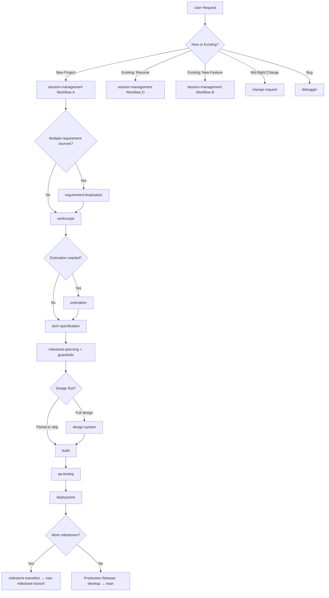

# Skill Registry

> **⚠ STATUS — historical reference only (v3.0 era).**
> This catalog reflects ADF v3.0 routing where the user invoked many skills directly
> (`/session-management` → `/workscope` → `/tech-specification` → …). That is no longer
> how the framework operates. From v4 onward there is **one user-facing entry: `/do`**,
> which dispatches the relevant specialist skills based on `AI_DOCS/` state.
>
> Authoritative sources for current behavior:
> - **Skill + agent registry: `skill-lab/catalog.yaml` (THE authoritative registry: IDs, versions, counts)**
> - Operating rules: `CLAUDE.md` (project root)
> - Memory schema: `skills/memory-protocol/SKILL.md`
> - Single entry: `skills/do/SKILL.md`
> - Active skill list: `templates/active-skills.md`
>
> Nothing in this file is maintained: its counts, tables, columns, and routing graphs are
> a v3.0-era snapshot. When this file and `skill-lab/catalog.yaml` (or an agent's own
> frontmatter in `agents/`) disagree, this file is wrong. Agents and skills carry no
> model tags: everything inherits the model set in the Claude CLI default settings.
>
> The IDs, dependencies, and capability mappings below are still useful as a *capabilities
> map* — but ignore the "Skill Routing Rules" graph and the per-skill "When to Use"
> instructions. /do decides when to dispatch, not the user.

> **Purpose** (historical): Central registry of all AI skills with capabilities and dependencies
> **Audience**: AI agents looking up which skill owns a capability
> **When**: During capability lookup; not for direct invocation by user

---

## Canonical SDLC Flow

```
[brainstorm*] → session-management → [requirement-finalization*] → workscope → [estimation*] → tech-specification → guardrails
  → [design-system*] → build → qa-testing → deployment

* = optional based on project type and user overrides. requirement-finalization runs when AI_DOCS/requirements/ holds more than one source. estimation is internal again as SK-162 (v4.13.0). project-brief (SK-164) is on-demand at any point after a baseline or workscope exists.
```

- **brainstorm** (`brainstorm`) is **pre-discovery** — use when exploring "should we build this?" before committing to workscope. Spawns `business-strategist` agent for business model, ICP, and revenue analysis.
- PRD/FRD skill (`prd-generation`) is **supplemental** and now produces both PRD and FRD. Use for large enterprise projects that require formal requirements documents alongside workscope.
- Design is **partial** by default — only design what's needed before coding starts. Code and design can leapfrog each other per milestone.

---

## Standardized Gate Reference

All skills use these gate IDs. No variations.

| Gate ID | Name | Passed When |
|---|---|---|
| Gate 0 | Workscope Approved | User signs off workscope.md |
| Gate 1 | Planning Completeness | User approves all 23 sections of tech-spec.md + design IA + infra-plan + Activation Map |
| Gate 1.5 | Code Quality Pre-Check | 17-point checklist passes before each coding session |
| Gate 2 | Component Library Ready | Design DNA approved + component registry initialized |
| Gate 3 | Design Approved | Screens for current milestone approved by user |
| Gate 4 | QA Sign-off | All test cases pass, no critical defects |
| Gate 5 | Scope Closure & Production Sign-off | Scope-closure report PASS (every scoped feature → DONE task, no gold-plating, CRs propagated, drift clean) + deployment checklist cleared, monitoring confirmed |

---

## Skill Catalog

### Core SDLC Skills (Primary Flow)

| ID | Skill | Capabilities | Dependencies | When to Use |
|----|-------|--------------|--------------|-------------|
| SK-000 | `memory-protocol` | read, write, sync | none | Protocol — every skill follows this |
| SK-001 | `session-management` | init, restore, handoff, routing, git-init, claude-md | none | Entry point for ALL workflows |
| SK-163 | `requirement-finalization` | multi-source reconciliation, conflict decision cards, requirements-baseline with source traceability | SK-001 | Stage 0.9: Requirements reconciliation (when more than one client source exists) |
| SK-072 | `workscope` | discovery (35 questions), baseline pre-fill, scope-doc (12-section client template, per-milestone acceptance criteria), tech-selection | SK-001 | Stage 1: Client-facing scope (replaces PRD for most projects) |
| SK-073 | `estimation` | RETIRED 2026-06-12 (moved out), superseded by SK-162 (2026-08-03). ID never reused. | SK-072 | Historical row |
| SK-164 | `project-brief` | short complexity brief, client/team variants, audience/purpose/length/tone intake gate | SK-072 | On-demand: stakeholder summary or onboarding brief |
| SK-070 | `tech-specification` | 23-section spec (incl. compliance matrix, traceability, cross-cutting, public surface), api-contract, schema, test-cases | SK-072 | Stage 2: Developer spec |
| SK-144 | `infra-planning` | environments, FE+BE topology, secrets, CI/CD, monitoring, DR, cost-at-scale | SK-070 | Stage 2.5: Infrastructure plan (non-POC) |
| SK-060 | `milestone-planning` | roadmap, gate-checklist, branch-creation, transition, `needs:` skill tags | SK-070 | Stage 2.5: Execution roadmap + Git branches |
| SK-006 | `guardrails` | generate, validate, 80+ rules | SK-070 | Stage 2.5: Project quality rules |
| SK-071 | `code-quality` | 17-point pre-check, sonarqube-sim | SK-070 | Gate 1.5: Before every coding session |
| SK-152 | `ux-foundation` | Phase 0 design gate: roles, JTBD (outcomes), NFR contract, success metrics; Gate UX-0 | SK-070 | Stage 2.9: requirement decomposition before any design (gated) |
| SK-004 | `design-discovery` (+`design-tokens` SK-046, `design-screens` SK-047) | design-dna, wireframe, mockup, component-library. Split from design-system 3.1.0 | SK-070 | Stage 3: UI/UX (can be partial per milestone) |
| SK-149 | `design-direction` | 2-3 live HTML mockups, pick-a-direction, requirement/UX gap flagging (grayscale Gate UX-1 first) | SK-004 | Stage 3: between design-discovery and design-tokens — what the user picks is what gets built |
| SK-005 | `developer-workflow` | DEPRECATED 4.9.0 → `build` | SK-070, SK-006 | Merged into build (per-task implement + verify) |
| SK-007 | `qa-testing` | plan, execute, report | SK-006 | Stage 4: Quality assurance |
| SK-009 | `security-audit` | DEPRECATED 4.9.0 → `audit` | SK-005 | Merged into audit (security + secrets + a11y + OWASP) |
| SK-008 | `deployment-planning` (+`deployment-execution` SK-045) | staging, production, rollback, git-release, tag. Split from deployment 3.1.0 | SK-007 | Stage 5: Release |
| SK-080 | `project-context` | generate, sync, update CLAUDE.md. Renamed from claude-md 3.1.0 | SK-001, SK-000 | On project init, session restore, milestone change |

### Requirements Skills (Supplemental)

> Use these for large enterprise projects that require formal requirements docs in addition to workscope.

| ID | Skill | Capabilities | Dependencies | When to Use |
|----|-------|--------------|--------------|-------------|
| SK-002 | `prd-generation` | generate, validate, gap-analysis; PRD + FRD (Given-When-Then) since 4.9.0 | SK-001 | Optional: Formal product and functional requirements |
| SK-003 | `frd-generation` | DEPRECATED 4.9.0 → `prd-generation` | SK-002 | Merged into prd-generation (FRD Mode) |

### Utility Skills

| ID | Skill | Capabilities | Dependencies | When to Use |
|----|-------|--------------|--------------|-------------|
| SK-096 | `brainstorm` | ideation, business-model, ICP, revenue-model, hosting-cost, MVP-options | none | Pre-discovery: explore idea before workscope |
| SK-010 | `change-request` | mid-flight-change, spec-update, task-update | SK-070 | Mid-development: unplanned feature requested |
| SK-011 | `mock-data` | generate, validate, json | SK-070 | Before design/dev: realistic test data |
| SK-012 | `project-types` | poc, mvp, production, standards-per-type | SK-001 | Project scope decision |
| ~~SK-013~~ | ~~discovery~~ | MERGED into `workscope` Phase 1 | - | - |
| SK-024 | `gate-enforcement` | define, check, enforce gates | SK-001 | Gate configuration and validation |
| SK-153 | `authz-matrix` | generate RBAC matrix (role x endpoint) from S3 + api-contract, per-cell tests (allow/deny/own-only/cross-tenant), emit mavs/authz.json | SK-011 | RBAC correctness validation (dispatched by /do) |
| SK-154 | `schema-validation` | run migrations up/down/up on a throwaway DB, diff vs database-schema.md, emit mavs/schema.json | SK-022 | DB schema correctness validation (dispatched by /do) |
| SK-155 | `api-conformance` | generate OpenAPI + diff vs api-contract, runtime status-code + envelope assertions, emit mavs/api.json | AG-012 | API runtime correctness validation (dispatched by /do) |
| SK-025 | `memory-protocol` | read-write contract for all skills | none | Protocol reference — not invoked directly |

### Infrastructure Skills

| ID | Skill | Capabilities | Dependencies | When to Use |
|----|-------|--------------|--------------|-------------|
| SK-020 | `architecture` | system-design, adr, api-contract, diagrams | SK-070 | Before development: architectural decisions |
| SK-021 | `github-ops` | branching, commits, PRs, releases, tags, milestone-lifecycle | SK-001 | All version control operations |
| SK-022 | `data-migration` | schema, seed, migrate, rollback | SK-005 | Database schema changes |
| SK-023 | `mcp-connector` | connect, configure MCP servers | SK-001 | MCP server setup and config |
| SK-156 | `operations` | day-2 ops: hotfix, monitoring cadence, on-call, seeded maintenance jobs, FinOps, verified billing alarm | SK-000 | After go-live (dispatched by /do Phase 4) |
| SK-157 | `incident-response` | SEV classify, incident-commander loop, timeline, comms, blameless postmortem handoff | SK-000 | Live production incident |

### Platform-Specific Skills

| ID | Skill | Capabilities | Dependencies | When to Use |
|----|-------|--------------|--------------|-------------|
| SK-087 | `reactjs` | project structure, custom hooks, RHF+Zod forms, performance hooks, Context API, Zustand, compound components, React 18/19 APIs, refs, code splitting, testing, TypeScript generics | SK-005 | React component patterns, hooks, state management, form handling |
| ~~SK-RN01~~ | ~~react-native~~ | MERGED into `rules/mobile-rules.md` + `build` | - | - |

### Python Backend Skills

> Use these for all work in `ai-server/` — the FastAPI Python backend. They mirror the core SDLC chain but enforce Python/async conventions, ABC provider patterns, and AI service architecture.

| ID | Skill | Capabilities | Dependencies | When to Use |
|----|-------|--------------|--------------|-------------|
| SK-083 | `python-ai-services` | LLM providers, RAG pipelines, embeddings, vector stores, agent orchestration, voice agents, MCP | SK-082, SK-070 | Adding AI integration features — LLM, RAG, embeddings, agents |
| SK-084 | `python-testing` | pytest, pytest-asyncio, httpx AsyncClient, AsyncMock, coverage, conftest fixtures | SK-082, SK-006 | Writing Python tests and QA for ai-server |
| SK-085 | `python-deployment` | uvicorn worker config, gunicorn UvicornWorker, Dockerfile multi-stage, zero-downtime, rollback | SK-084 | Deploying ai-server to staging or production |

### Go Backend Skills

> Use these for all work in a Go service. They mirror the core SDLC chain but enforce Go idioms: handler->service->store layering, context-first signatures, bounded goroutines, error wrapping, and graceful shutdown. Pair with the `go-specialist` agent for concurrency/architecture review and the `go-rules.md` baseline.

| ID | Skill | Capabilities | Dependencies | When to Use |
|----|-------|--------------|--------------|-------------|
| SK-160 | `go-testing` | table-driven tests, httptest, testify/gomock at the interface boundary, race detector, coverage, MAVS go-test.json | SK-159, SK-006 | Writing Go tests and QA for a Go service |
| SK-161 | `go-deployment` | CGO_ENABLED=0 static binary, distroless/scratch multi-stage image, health/readiness, graceful shutdown, zero-downtime, rollback | SK-160 | Deploying a Go service to staging or production |
| SK-162 | `estimation` | v6 simple workbook: Summary, Features, Tasks, Recommended, Validation. Minimum hours per role (UI/UX to PM), feature priority and recommendation, Approved / Proposed / Deferred / Excluded / Unestimated kept apart, live validation checks, provisional ETA only from scheduling inputs, no margin | SK-108 (xlsx) | Sizing effort or a timeline from a workscope, tech-spec, or task plan |

### Optimization Skills

| ID | Skill | Capabilities | Dependencies | When to Use |
|----|-------|--------------|--------------|-------------|
| ~~SK-030~~ | ~~performance~~ | MERGED into `guardrails` Performance Targets section | - | - |
| SK-031 | `caching-strategy` | multi-layer cache, ttl, invalidation | SK-005 | Caching design and implementation |
| ~~SK-032~~ | ~~token-optimizer~~ | MERGED into `memory-protocol` Context Optimization section | - | - |
| SK-033 | `seo` | meta, sitemap, structured-data | SK-005 | SEO requirements |
| SK-034 | `i18n` | setup, keys, rtl, locales | SK-005 | Multi-language support |

### Reliability Skills

| ID | Skill | Capabilities | Dependencies | When to Use |
|----|-------|--------------|--------------|-------------|
| SK-040 | `error-handling` | catch, recover, retry, boundaries | any | Error handling patterns |
| SK-041 | `debugger` | analyze, trace, root-cause, fix | SK-005 | Bug investigation |
| SK-042 | `audit-logs` | structured-log, retention, compliance | any | Audit trail / compliance |
| SK-043 | `analytics` | event-tracking, kpis, dashboards | SK-008 | Usage analytics setup |
| SK-150 | `e2e-testing` | seed-login, mock MFA/OTP/email, auth-state reuse, isolation, web+native E2E | SK-007, SK-011 | Full-milestone E2E with real auth (milestone-validation Phase 1b) |
| SK-151 | `landing-page` | high-converting marketing landing: funnel-mapped anatomy, one primary CTA, technical SEO (structured data, Core Web Vitals), GTM/GA4 instrumentation spec | SK-046 | Marketing/conversion page design, parallel to design-screens; hands wiring to seo + analytics |

### Document Skills

| ID | Skill | Capabilities | Dependencies | When to Use |
|----|-------|--------------|--------------|-------------|
| SK-047 | `docx` | create, read, edit Word documents | none | .docx file manipulation |
| SK-048 | `pdf` | create, read, extract PDFs | none | PDF generation/reading |
| SK-051 | `image-assets` | generate, optimize images | SK-004 | Image generation and optimization |
| SK-054 | `markdown-creator` | best-practice markdown (headings, GFM callouts, code fences, 300-line cap + folder-split), templates for runbook/ADR/technical doc | none | Any time user asks for a .md file or a skill needs to emit markdown that humans and agents will read |

### Quality & Audit Skills

| ID | Skill | Capabilities | Dependencies | When to Use |
|----|-------|--------------|--------------|-------------|
| SK-081 | `project-audit` | full codebase scan, guardrail check, API contract validation, fix-plan | SK-001 | End of milestone, before release, when bugs appear, health check |

### Meta Skills

| ID | Skill | Capabilities | Dependencies | When to Use |
|----|-------|--------------|--------------|-------------|
| SK-044 | `mock-api-server` | mock endpoints, templates, json-server | SK-070 | Frontend dev before backend ready |
| SK-053 | `codebase-migration` | scan, analyze, retroactive-docs, onboard | none | Onboarding existing projects |
| SK-086 | `skill-router` | condensed skill knowledge base, intent-to-skill routing, session-start reference | none | SessionStart hook, skill discovery, "what skill should I use" |
| ~~SK-050~~ | ~~skill-orchestrator~~ | MERGED into `session-management` workflow detection | - | - |

### Team Orchestration Skills (ADF 3.0 — context: fork)

> These skills spawn multiple agents in parallel and coordinate them. Each runs in isolated subagent context (fork) to protect the main conversation. Each is a complete mini-pipeline with built-in gates.

| ID | Skill | Capabilities | Dependencies | When to Use |
|----|-------|--------------|--------------|-------------|
| SK-088 | `team-feature` | scope gate → architecture gate → feasibility gate → parallel specialist implementation → code review → QA gate → summary | SK-001, SK-070 | Deliver a full feature end-to-end with all gates |
| SK-089 | `team-release` | release readiness → security scan + QA gate (parallel) → PHASE-GATE → deployment | SK-088, SK-007 | Prepare and ship a milestone release |
| SK-090 | `team-security` | parallel security-auditor + api-validator + code-reviewer → consolidated findings with severity | SK-005 | Run a complete security sweep on current codebase |
| SK-091 | `team-design` | scope gate → component reuse check (parallel) → specialist implementation plan → implementation → compliance verification | SK-004, SK-070 | Deliver a screen or design-heavy feature |

### Framework Quality Skills (ADF 3.0)

| ID | Skill | Capabilities | Dependencies | When to Use |
|----|-------|--------------|--------------|-------------|
| SK-092 | `project-stage-detect` | reads gate-status.md → scans AI_DOCS → scans codebase → detects SDLC phase → lists missing artifacts → recommends next skill | SK-001 | When unsure what phase you're in or where to start |
| SK-093 | `skill-test` | static (7 structural checks), spec (5 behavioral test cases), category (rubric evaluation), audit (coverage dashboard) | none | QA the ADF framework itself |
| SK-094 | `skill-improve` | read → static check → category check → diagnose → propose → apply → retest → verdict | SK-093 | Improve a failing or weak skill file |

### AI Cost Control Skills (ADF 3.0)

| ID | Skill | Capabilities | Dependencies | When to Use |
|----|-------|--------------|--------------|-------------|
| SK-095 | `ai-cost-guard` | cost estimation, risk flag analysis (11 risks), optimization recommendations, written approval gate, implementation guidelines | none | Before implementing any LLM API integration |
| SK-146 | `infra-cost-guard` | per-resource + total monthly cost table, delta vs approved spend, growth projection, risk flags (10 risks), optimization recommendations, written approval ledger (`infra-cost-approvals.md`), hook-enforced gate on terraform/cloud CLI (`infra-cost-gate.sh`) | none (pairs with infra-planning, deployment-planning) | Before any cloud resource is provisioned, resized, or added to a Terraform plan |

---

## Skill Routing Rules



---

## Skill Lookup by Capability

| Capability | Primary Skill | Fallback |
|------------|---------------|----------|
| `init` | session-management | - |
| `finalize-requirements` | requirement-finalization | - |
| `scope` | workscope | - |
| `estimate` | estimation | - |
| `summary-brief` | project-brief | workscope |
| `requirements` | tech-specification | workscope |
| `formal-requirements` | prd-generation (PRD + FRD mode) | - |
| `design` | design-system | - |
| `implement` | build | - |
| `mobile` | build + rules/mobile-rules.md | - |
| `test` | qa-testing | build |
| `deploy` | deployment | - |
| `git` | github-ops | - |
| `debug` | debugger | error-handling |
| `optimize` | guardrails (PERF section) | caching-strategy |
| `memory` | memory-protocol | session-management |
| `context-file` | claude-md | memory-protocol |
| `milestone-transition` | milestone-planning | github-ops |
| `feature-pipeline` | team-feature (SK-088) | build |
| `release-pipeline` | team-release (SK-089) | deployment |
| `security-sweep` | team-security (SK-090) | audit |
| `design-pipeline` | team-design (SK-091) | design-system |
| `detect-phase` | project-stage-detect (SK-092) | session-management |
| `test-skill` | skill-test (SK-093) | - |
| `improve-skill` | skill-improve (SK-094) | - |
| `ai-cost-check` | ai-cost-guard (SK-095) | - |
| `infra-cost-check` | infra-cost-guard (SK-146) | infra-planning |

---

## Technology → Skill Routing

When the tech stack is confirmed, automatically suggest these skills:

| Tech Stack Includes | Suggest Skill |
|---|---|
| React Native (iOS/Android) | `build` + `.claude/rules/mobile-rules.md` |
| PostgreSQL / MySQL | `data-migration` (SK-022) — for all schema changes |
| MongoDB | `data-migration` (SK-022) — for migrations and seeding |
| Any frontend | `design-discovery` (SK-004): Design DNA first |
| Multi-language requirement | `i18n` (SK-034) — setup before first string |
| SEO requirement | `seo` (SK-033) — setup before deployment |
| Compliance requirement | `audit-logs` (SK-042) — setup with project init |
| **Python / FastAPI (`ai-server/`)** | `build` + `fastapi-specialist` agent → [`python-ai-services` (SK-083)*] → `python-testing` (SK-084) → `python-deployment` (SK-085) |
| **LLM / RAG / AI integrations** | `python-ai-services` (SK-083) — after the backend foundation is set |
| **Go service** | `build` + `go-specialist` agent → `go-testing` (SK-160) → `go-deployment` (SK-161) |
| Supabase (Postgres BaaS / auth / storage / edge functions) | run `npx skills add supabase/agent-skills` — installs the official Supabase agent skills into `.claude/skills/` (external pack, gitignored). Install when Supabase is added to the stack, not preemptively. |

---

## Agents (.claude/agents/)

Specialist subagents that Claude auto-delegates to based on description. Run in isolated context.

### Tier 1 — Leadership (maxTurns: 25)

| Agent | File | Purpose | Gate Verdicts |
|---|---|---|---|
| solutions-architect | `.claude/agents/solutions-architect.md` | Architecture decisions, ADRs, tech stack, API boundaries | SA-ARCH, SA-ADR |
| product-director | `.claude/agents/product-director.md` | Scope validation, milestones, prioritization, change requests | PD-SCOPE, PD-MILESTONE |
| engineering-lead | `.claude/agents/engineering-lead.md` | Implementation feasibility, code standards, cross-team coordination | EL-FEASIBILITY |
| data-architect | `.claude/agents/data-architect.md` | Schema design, indexing, query plans, migration safety at scale, N+1 ownership | DA-SCHEMA (at SA-ARCH / schema) |
| sre-reliability | `.claude/agents/sre-reliability.md` | Observability, SLOs/error budgets, rollback/DR safety, capacity, production readiness | SRE-READY (Gate 5) |
| compliance-officer | `.claude/agents/compliance-officer.md` | GDPR/HIPAA/SOC2/PCI control verdicts against rules/compliance/*; required vs addressable | CO-COMPLIANCE (when compliance != none) |

### Tier 2 — Specialist Leads (maxTurns: 10-20)

| Agent | File | Purpose | Auto-triggers on |
|---|---|---|---|
| code-reviewer | `.claude/agents/code-reviewer.md` | Review code against all 6 rule categories | "review this code", "check this file" |
| security-auditor | `.claude/agents/security-auditor.md` | OWASP security audit, hardcoded secrets, threat modeling | "security check", "is this secure" |
| api-validator | `.claude/agents/api-validator.md` | API contract sync check with mismatch types | "check API contract", "API mismatch" |
| test-writer | `.claude/agents/test-writer.md` | Write Given-When-Then tests for modules | "write tests for", "add tests" |
| component-inspector | `.claude/agents/component-inspector.md` | Component registry, design token compliance, accessibility | "check components", "design compliance" |
| ux-advisor | `.claude/agents/ux-advisor.md` | Requirement-gap + weak-UX critique (control-pattern fitness, missing states) | spawned by design-direction / workscope |
| principal-designer | `.claude/agents/principal-designer.md` | Built-craft review + design authorship: hierarchy, 8pt rhythm, alignment, density, milestone uniformity (verdict APPROVE/CONCERNS/REJECT) | spawned by design-screens / build (UI) / milestone close |

### Tier 3 — Platform Specialists (maxTurns: 15)

| Agent | File | Specialization |
|---|---|---|
| react-specialist | `.claude/agents/react-specialist.md` | React hooks, state mgmt (Zustand/Redux/Jotai), performance, testing |
| nextjs-specialist | `.claude/agents/nextjs-specialist.md` | App Router, RSC, SSR/SSG/ISR, API routes, middleware |
| angular-specialist | `.claude/agents/angular-specialist.md` | Module system, DI, RxJS/signals, NgRx, standalone components |
| vue-specialist | `.claude/agents/vue-specialist.md` | Vue 3 Composition API, reactivity, Pinia, Vue Router, Nuxt 3 rendering and data fetching |
| nodejs-specialist | `.claude/agents/nodejs-specialist.md` | Event loop, streams, worker threads, Express/Fastify |
| go-specialist | `.claude/agents/go-specialist.md` | Goroutines + channels, context propagation, net/http + chi/echo/gin, pgx/sqlc, graceful shutdown |
| nestjs-specialist | `.claude/agents/nestjs-specialist.md` | Modules, DI, Prisma/TypeORM, CQRS, BullMQ, microservices |
| fastapi-specialist | `.claude/agents/fastapi-specialist.md` | Async handlers, Pydantic v2, SQLAlchemy async, Alembic, OAuth2 |
| flutter-specialist | `.claude/agents/flutter-specialist.md` | Widget tree, Riverpod/Bloc, platform channels, animations |
| react-native-specialist | `.claude/agents/react-native-specialist.md` | Expo managed/bare, New Architecture (JSI/Fabric), EAS Build |

### v5 — Domain leads, builder, utility (context-isolating; added 4.11.0)

Leads carry the `Agent` tool and dispatch specialists in their own isolated context (read/advise/review, never edit). The `builder` applies a lead's plan with edits enforced by the same PreToolUse hooks. Utility agents are read-only.

| Agent | File | Role |
|---|---|---|
| frontend-lead | `.claude/agents/frontend-lead.md` | Dispatches frontend specialists, returns one consolidated UI plan |
| backend-lead | `.claude/agents/backend-lead.md` | Dispatches backend specialists + api-validator + security-auditor, returns endpoints/layering/authz/async plan |
| quality-lead | `.claude/agents/quality-lead.md` | Dispatches code-reviewer + test-writer + security-auditor, returns must-fix vs optional + test plan + coverage gaps |
| design-lead | `.claude/agents/design-lead.md` | Dispatches principal-designer + ux-advisor + component-inspector, returns a production-grade design plan |
| research-lead | `.claude/agents/research-lead.md` | Fans out explorer/Explore workers in parallel, returns one consolidated cited answer |
| builder | `.claude/agents/builder.md` | Applies a lead's plan in isolated context, runs the verify battery, returns a diff + results |
| explorer | `.claude/agents/explorer.md` | Read-only investigation in isolated context; returns summaries to protect main context |
| learning-curator | `.claude/agents/learning-curator.md` | Abstracts project learnings into a human-gated framework-improvement proposal (read-only, never commits) |

## Forked Skills (context: fork)

These skills run in isolated subagent context to avoid polluting main conversation:
- `project-audit` (SK-081) — heavy codebase scan
- `audit` (SK-132): security, secrets, a11y, OWASP
- `code-quality` (SK-071) — 17-point checklist
- `team-feature` (SK-088) — full feature pipeline with gates
- `team-release` (SK-089) — release pipeline
- `team-security` (SK-090) — parallel security sweep
- `team-design` (SK-091) — design delivery pipeline

---

## Adding New Skills

1. Create folder: `.claude/skills/[skill-name]/`
2. Create `SKILL.md` with standard frontmatter header
3. Assign next available SK-ID (check this registry first — no collisions)
4. Add entry to this registry under the correct category
5. Update `session-management` routing table if it's a primary flow skill
6. Add to `README.md` skill reference

**Next available IDs**: SK-156 ... (SK-149 design-direction, SK-150 e2e-testing in v4.5.0; SK-151 landing-page in v4.6.0; SK-152 ux-foundation, SK-153 authz-matrix, SK-154 schema-validation, SK-155 api-conformance in v4.9.0; AG agent ux-advisor, principal-designer added)
*(SK-082–SK-085: Python Backend. SK-086: skill-router. SK-087: reactjs. SK-088–SK-091: team orchestration. SK-092: project-stage-detect. SK-093: skill-test. SK-094: skill-improve. SK-095: ai-cost-guard.)*

---

*Part of ADF (App Development Framework) v3.0 — evolved from AI_SKILLS Framework v2.0*
*Last Updated: 2026-04-14*
