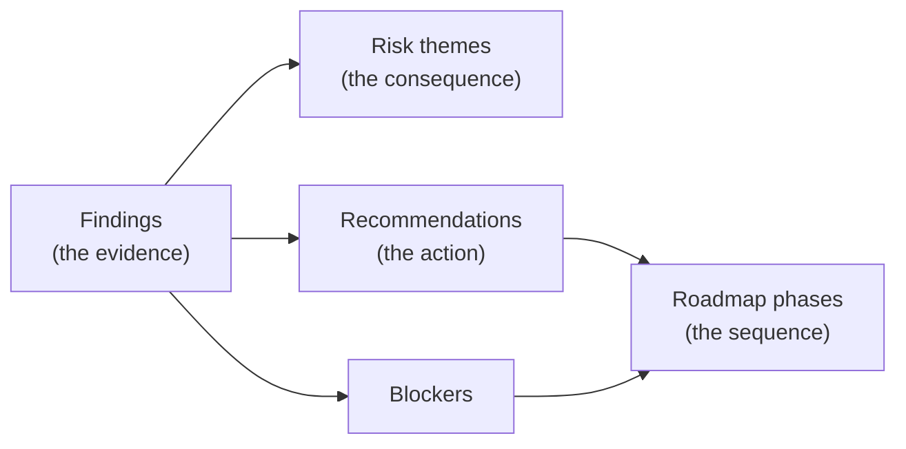

# Traceability Contract

> The chain that makes an assessment package auditable rather than assertive. Enforced programmatically
> at the Phase 3 validation gate, not by eye.

---

## The chain



Each arrow is a real reference by identifier, not a narrative gesture. A reader must be able to start at
any roadmap item and walk back to the file and line that justifies it.

## Cardinality

| Relationship | Cardinality | Note |
|---|---|---|
| Finding to risk | Many to one | A risk theme groups findings that share a consequence |
| Finding to recommendation | Many to one | One action often closes several findings |
| Recommendation to phase | One to many | A recommendation can span phases (introduce, then migrate) |
| Blocker to finding | One to many | A blocker affects everything it prevents assessing |
| Finding to risk | Optional | Not every finding drives a business risk. Low-severity debt usually does not |
| Finding to recommendation | **Mandatory for Critical and High** | See the gate below |

## The gate

**Every Critical and High finding must map to a specific recommendation.** Not a collective bucket.

This is the check most likely to fail, and it fails quietly. In the real engagement, three
Critical-or-High findings landed in the collective bucket on first build and had to be mapped explicitly.
Two were bug-risk findings that did not obviously belong to a named recommendation, and one was a
process-level meta-finding.

```python
ch = [f for f in findings if f.severity in ("Critical", "High")]
unmapped = [f.id for f in ch if rec_for(f.id) in (None, "(collective)")]
assert not unmapped, f"unmapped Critical/High: {unmapped}"
```

Medium and Low findings **may** map to collective recommendations. When they do, say so explicitly in the
report so the reader knows the grouping is deliberate rather than an oversight.

## What each object must carry

### Finding
ID, problem, file location, line where applicable, expected state, severity, type, area, evidence grade,
effort.

### Risk theme
A name, the finding IDs supporting it, severity, technical impact, business impact, recommended response.
Business impact belongs **here**, not on individual findings.

### Recommendation
ID, title, category, the problem addressed, related finding IDs, reason, expected outcome, priority,
effort, dependencies, and the risk of deferring.

### Roadmap item
Phase, work item, recommendation IDs, finding IDs, effort, dependencies, exit criteria, parallelism.

### Blocker
ID, what it prevents, why it matters, related finding IDs, cost to close, recommended resolution, and the
phase in which it is resolved.

## Carrying traceability into the workbook

The detail sheet gains derived columns so a reader filtering to one recommendation sees exactly which
findings it covers:

| Added column | Source |
|---|---|
| Recommendation ID | The finding-to-recommendation mapping |
| Priority | Inherited from the recommendation, not from severity |
| Roadmap phase | Inherited from the recommendation |
| Risk theme | The finding-to-risk mapping, blank where the finding drives no named risk |

Keep every original column. Derived columns are added, never substituted.

## Validation queries

Run all of these before delivery:

```python
# 1. Every Critical/High has a specific recommendation
assert not [f.id for f in findings
            if f.severity in ("Critical","High") and rec_for(f.id) == "(collective)"]

# 2. Every referenced finding ID exists
all_ids = {f.id for f in findings}
for r in risks + recommendations + blockers:
    assert set(r.finding_ids) <= all_ids, f"{r.id} cites unknown findings"

# 3. Every roadmap item cites a real recommendation
rec_ids = {r.id for r in recommendations}
for item in roadmap_items:
    assert set(item.rec_ids) <= rec_ids

# 4. Totals agree across every document
for doc in documents:
    assert doc.stated_total == len(findings)
```

## Reporting the chain to the client

Include a short traceability summary table in the recommendation report:

| Layer | Count | Where |
|---|---|---|
| Findings | n | Workbook, Detailed Findings |
| Risk themes | 8 to 12 | Report, Top Risks |
| Recommendations | 20 to 40 | Recommendation Report |
| Roadmap phases | 5 to 8 | Roadmap |
| Blockers | as found | Roadmap and Workbook |

State explicitly that every Critical and High finding maps to a recommendation, and that the remaining
findings are covered collectively. That sentence is what tells a technical reader the package is complete
rather than selective.
