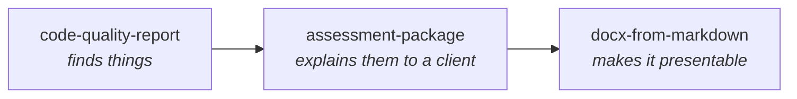

# Assessment Tooling: How the Pieces Fit

> Quick orientation for whoever picks this up next. Two skills, thirteen agents, one workflow.

---

## The division of labour



| Skill | Job | Output |
|---|---|---|
| `code-quality-report` | SonarQube-style analysis of a codebase | Findings register plus a technical report |
| `assessment-package` | Turn findings into a consulting deliverable | Four client-facing files |
| `docx-from-markdown` | Branded Word output | DOCX |

Both analysis and packaging fire **only on explicit request**. Neither should trigger from a generic
"review this".

---

## When to use which

| Situation | Use |
|---|---|
| "Run a code quality check on this repo" | `code-quality-report` alone |
| "We have findings, produce the client reports" | `assessment-package` alone, pointed at the register |
| "Do a full discovery assessment and give me the deliverables" | The `assessment-package` workflow, which runs both |
| "Just convert this markdown to Word" | `docx-from-markdown` |

---

## Agents

**Analysis (9), prefix `cq-`.** Each owns one dimension and confirms every claim by reading:

`cq-bugs-reliability` · `cq-security-vulns` · `cq-security-hotspots` · `cq-complexity` ·
`cq-duplication` · `cq-dead-code` · `cq-test-quality` · `cq-configuration` · `cq-dependencies`

**Packaging (4), prefix `ap-`.** Sequential, because each depends on the last:

`ap-data-reconciler` → `ap-risk-synthesist` → `ap-recommendation-architect` → `ap-roadmap-planner`

---

## The workflow

`.claude/workflows/assessment-package.js` runs the whole pipeline: recon, nine agents in parallel,
reachability arbitration and reconciliation, then the three synthesis passes in order. It returns the
synthesis for the main session to author from.

```
Workflow({ scriptPath: ".claude/workflows/assessment-package.js",
           args: { repo: "<path>", client: "<name>", platform: "<name>", version: "<x.y.z>" } })
```

Pass `findings: "<path>"` to skip the analysis phase and package an existing register.

**Workflows require explicit user opt-in.** Do not launch this on inference.

---

## The four rules that matter most

Everything else in these skills is detail. These four are why the tooling exists.

### 1. A count is not a finding

Six repository-wide scans in one engagement produced results that per-file reading refuted, including two
that reached draft documents. Every agent carries this warning, and every finding carries an evidence
grade.

### 2. Never trust a summary

A workbook stated 199 findings while its severity block summed to 132. The block was written once and
never refreshed. Reconcile before writing, and **generate summaries programmatically** so they cannot
drift again.

### 3. Trace each incident-log entry forward into current code

The single highest-yield technique available. On a real engagement it found a **live, unfixed instance of
an already-fixed bug**: a filter corrected in two sibling files, with a comment explaining why, and never
corrected in the primary one. Generic scanning would never have surfaced it, because the code looked
ordinary.

### 4. Report what you cleared

A report that only lists problems gives the reader no way to calibrate. The cleared list frequently
becomes the most useful section to the client's engineering team, because it stops them re-investigating
the same false positives forever.

---

## The validation gate

Before any deliverable ships, run these programmatically:

```
[ ] Every total in every document matches the computed value from the detail sheet
[ ] Every Critical and High finding maps to a SPECIFIC recommendation, not a collective bucket
[ ] Every cited finding, recommendation, and phase ID resolves
[ ] No duplicate or missing IDs, no blank required fields
[ ] Every "Unable to verify" names its blocker
[ ] Style: no em-dashes or en-dashes, no banned phrases
[ ] Tables destined for DOCX are at most 4 columns
```

The second check is the one that fails. Map the stragglers explicitly rather than leaving them collective.

---

## Known operational gotchas

| Gotcha | Handling |
|---|---|
| The workbook is open in Excel | The write is refused. Write the register to Markdown first, merge later |
| Async agents return only a notification | Use SendMessage to ask the agent to relay its final table |
| Wide tables break the DOCX template | Cap at 4 columns; keep a separate DOCX-ready markdown variant |
| Sentence-case headings | The DOCX style contract wants Title Case on H1 and H2 |
| `.claude/` is gitignored in some projects | These files will not be committed unless that changes |
