# Gate Status Template

> **Purpose**: Central tracking file for AI-driven quality gates
> **Location**: Created as `AI_DOCS/memory/gate-status.md` during project initialization
> **Updated By**: AI after each gate checkpoint

---

## Gate Status Dashboard

| Gate ID | Gate Name | Status | Approved By | Date | Notes |
|---------|-----------|--------|-------------|------|-------|
| 1A | PRD Draft Created | ⬜ Pending | - | - | - |
| 1B | PRD User Review | ⬜ Pending | - | - | - |
| 1C | PRD Final Approval | ⬜ Pending | - | - | - |
| 2A | FRD Draft Created | ⬜ Pending | - | - | - |
| 2B | FRD PRD Alignment | ⬜ Pending | - | - | - |
| 2C | FRD Gap Analysis | ⬜ Pending | - | - | - |
| 2D | FRD Final Approval | ⬜ Pending | - | - | - |
| 2E | Milestone Plan Approval | ⬜ Pending | - | - | - |
| 3A | Architecture Review | ⬜ Pending | - | - | - |
| 3B | Design System Defined | ⬜ Pending | - | - | - |
| 4A | Development Standards Set | ⬜ Pending | - | - | - |
| 4B | Unit Tests Passing | ⬜ Pending | - | - | - |
| 4C | Code Review Passed | ⬜ Pending | - | - | - |
| 5A | Pre-Deployment Check | ⬜ Pending | - | - | - |
| 5B | Staging Deployed | ⬜ Pending | - | - | - |
| 5C | Production Sign-off | ⬜ Pending | - | - | - |

---

## Status Legend

| Emoji | Meaning |
|-------|---------|
| ⬜ | Pending - Not started |
| 🔄 | In Progress |
| ✅ | Passed - Approved |
| ❌ | Failed - Needs rework |
| ⏸️ | Blocked |

---

## Gate Dependencies

```mermaid
graph LR
    1A[PRD Draft] --> 1B[PRD Review] --> 1C[PRD Approval]
    1C --> 2A[FRD Draft] --> 2B[FRD Alignment] --> 2C[FRD Gap] --> 2D[FRD Approval]
    2D --> 2E[Milestone Plan]
    2E --> 3A[Architecture] --> 3B[Design System]
    3B --> 4A[Dev Standards] --> 4B[Unit Tests] --> 4C[Code Review]
    4C --> 5A[Pre-Deploy] --> 5B[Staging] --> 5C[Production]
```

---

## Gate Validation Rules

> [!CRITICAL]
> **AI Enforcement**: Before starting any skill, check if prerequisite gates are ✅.

| Skill | Required Gates |
|-------|----------------|
| `prd-generation` | None (entry point) |
| `prd-generation` | 1C (PRD Approved) |
| `architecture` | 2D (FRD Approved) |
| `design-system` | 3A (Architecture Review) |
| `build` | 3B (Design System), 4A (Dev Standards) |
| `qa-testing` | 4B (Unit Tests) |
| `deployment` | 4C (Code Review), 5A (Pre-Deploy) |

---

## Changelog

| Date | Gate | Action | By |
|------|------|--------|-----|
| [ISO Date] | - | Template initialized | AI |

---

*Part of AI_SKILLS Framework*
*Template Version: 1.0.0*
