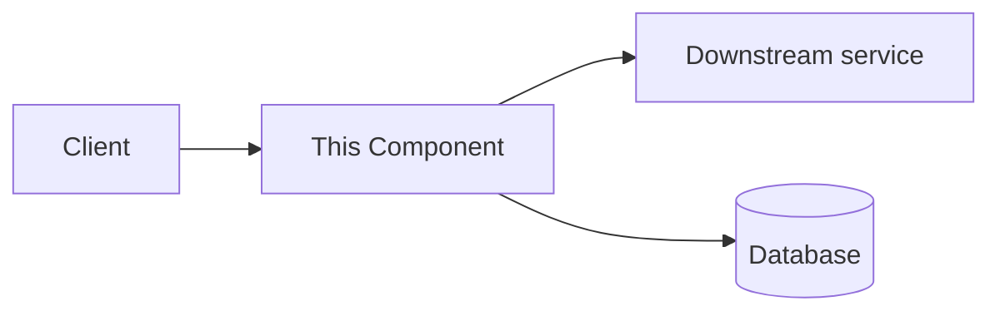

# <Feature / component / system> — Technical Reference

> <One-sentence purpose.> <One-sentence audience: who reads this and what do they need.>

**Last updated**: YYYY-MM-DD

---

## Contents

- [Overview](#overview)
- [Architecture](#architecture)
- [API / Interface](#api--interface)
- [Data model](#data-model)
- [Configuration](#configuration)
- [Operations](#operations)
- [Troubleshooting](#troubleshooting)
- [References](#references)

---

## Overview

### What it is

<One paragraph describing the component.>

### What it does

<Bullet list of responsibilities.>

- Responsibility 1
- Responsibility 2
- Responsibility 3

### What it doesn't do (non-goals)

- Non-goal 1
- Non-goal 2

---

## Architecture



### Dependencies

| Dependency | Type | Required | Notes |
|------------|------|----------|-------|
| <name>     | service / lib / env | yes / no | <one-liner> |

### Failure domains

- <What breaks if X goes down?>

---

## API / Interface

### Public surface

```ts
// Replace with the real interface/signature
interface Example {
  method(input: Input): Output;
}
```

### Endpoint — `METHOD /path`

**Purpose:** <one sentence>

**Request:**

```json
{
  "field": "value"
}
```

**Response (200):**

```json
{
  "result": "value"
}
```

**Errors:**

| Status | Code        | Meaning                    |
|--------|-------------|----------------------------|
| 400    | BAD_REQUEST | <when>                     |
| 404    | NOT_FOUND   | <when>                     |
| 500    | INTERNAL    | unhandled server error     |

---

## Data model

```ts
type Entity = {
  id: string;
  createdAt: string;  // ISO 8601
  // ...
};
```

### Invariants

- <Invariant 1 — always true, enforced how?>
- <Invariant 2>

### Migrations

<Brief note or link to the migration doc.>

---

## Configuration

### Environment variables

| Name                | Required | Default | Description |
|---------------------|----------|---------|-------------|
| `FEATURE_ENABLED`   | no       | `false` | <one-liner> |
| `API_TIMEOUT_MS`    | no       | `5000`  | <one-liner> |

### Feature flags

- `<flag-name>` — <what it gates>

---

## Operations

### How to deploy

> [!NOTE]
> Link to the full runbook if one exists; inline only the essentials here.

```bash
# Example deploy command
deploy --env=staging --service=<name>
```

### How to monitor

- **Key metric**: <name> — <what it means, threshold>
- **Dashboard**: [link](https://dashboard.example.com)
- **Alerts**: <where they page>

### How to roll back

```bash
# Example rollback
deploy --env=staging --service=<name> --revision=<previous>
```

---

## Troubleshooting

### <Common symptom>

**Cause:** <root>

**Diagnosis:**

```bash
# Command to confirm
diagnose-command --service=<name>
```

**Fix:** <steps>

### <Another symptom>

**Cause:** <root>

**Fix:** <steps>

---

## References

- [Design doc](./design.md)
- [Runbook](./runbook.md)
- [ADR-NNNN: <related decision>](../adr/NNNN-<slug>.md)
- [External spec](https://example.com/spec)
