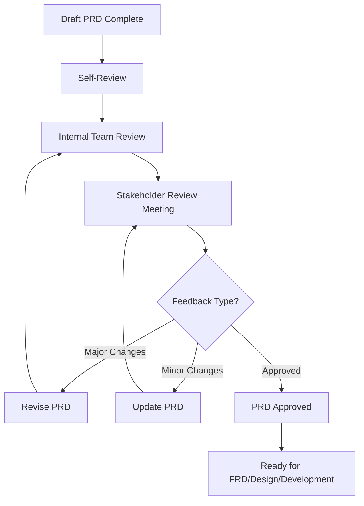

# PRD Examples & Supplementary Templates

> Extracted from [SKILL.md](SKILL.md) — Detailed examples, quality checklist, stakeholder review process, and competitive analysis templates.

---

## PRD Quality Checklist

Before submitting for stakeholder approval:

- [ ] **Problem Statement**: Clear, validated problem definition
- [ ] **User Research**: Minimum 5-10 user interviews conducted
- [ ] **Competitive Analysis**: Top 3-5 competitors analyzed
- [ ] **User Personas**: Primary and secondary personas documented
- [ ] **User Journeys**: Critical workflows mapped
- [ ] **Functional Requirements**: All features documented with user stories
- [ ] **Non-Functional Requirements**: Performance, security, scalability defined
- [ ] **Success Metrics**: Clear, measurable KPIs with targets
- [ ] **Prioritization**: Features prioritized with clear rationale
- [ ] **Roadmap**: Multi-phase release plan documented
- [ ] **Risks**: Risks identified with mitigation strategies
- [ ] **Dependencies**: All dependencies documented
- [ ] **Stakeholder Alignment**: Key stakeholders reviewed and approved

---

## Stakeholder Review Process



---

## Product Strategy Examples

### Vision Statement Template

```
We envision a future where [target users] can [desired outcome]
without [current pain point], enabling them to [ultimate benefit].
```

### Strategic Pillars Example

1. **User-Centered Design**: Every feature must delight users
2. **Enterprise-Grade Security**: Security is non-negotiable
3. **Native Integration**: Work with existing tools, no separate setup

### Success Metrics Hierarchy Example

**Business Metrics** (North Star):
- Primary: Revenue, ARR, Active Users
- Secondary: Customer Acquisition Cost, Lifetime Value

**Product Metrics** (Engagement):
- Activation: Time to first value
- Engagement: Daily/Weekly Active Users
- Retention: Day 7/30/90 retention

**Feature Metrics** (Impact):
- Adoption: % of users using feature
- Usage: Frequency of feature use
- Satisfaction: NPS, CSAT scores

---

## Competitive Analysis Template

### Market Landscape Table

| Competitor | Strengths | Weaknesses | Market Share | Pricing |
|------------|-----------|------------|--------------|---------|
| [Competitor 1] | [Strengths] | [Weaknesses] | [%] | [$] |
| [Competitor 2] | [Strengths] | [Weaknesses] | [%] | [$] |

### Feature Comparison Matrix

| Feature | Us | Competitor 1 | Competitor 2 | Competitive Advantage |
|---------|----|--------------|--------------|-----------------------|
| [Feature 1] | Y | Y | N | Parity |
| [Feature 2] | Y | N | N | **Differentiator** |

---

## User Story Quality (INVEST Criteria)

Every user story must be:

| Criterion | Description | Example |
|-----------|-------------|---------|
| **Independent** | Can be developed independently | "User can reset password" vs "User can complete step 3 of registration" |
| **Negotiable** | Details can be discussed | Open to how password reset is implemented |
| **Valuable** | Delivers value to users/business | Clear benefit stated in "So that" clause |
| **Estimable** | Can be estimated by engineering | Enough detail for effort estimate |
| **Small** | Can be completed in one sprint | Broken down to 1-5 day efforts |
| **Testable** | Has clear acceptance criteria | Given-When-Then format |

---

## Acceptance Criteria Quality

Every acceptance criterion must be:
- **Specific**: Clearly states expected behavior
- **Testable**: Can be verified by QA
- **Necessary**: Essential for feature to work
- **Complete**: Covers happy path, error cases, edge cases

---

## Problem Statement Template

```
For [target user]
Who [user need or pain point]
The [product name]
Is a [product category]
That [key benefit]
Unlike [alternatives]
Our product [unique differentiator]
```

---

## Feature Prioritization Matrix Template

| Feature | User Impact | Business Value | Effort | Priority | Phase |
|---------|-------------|----------------|--------|----------|-------|
| [Feature] | High/Med/Low | High/Med/Low | Low/Med/High | Must/Should/Could | v1.0/v1.1/v2.0 |

---

## Production-Grade PRD Includes

- Comprehensive user research (interviews, surveys, data analysis)
- Detailed competitive analysis (5+ competitors analyzed)
- Complete user personas (primary + secondary + edge cases)
- Detailed user journeys for all roles
- Complete functional and non-functional requirements
- Risk assessment and mitigation strategies
- Multi-phase release roadmap
- Stakeholder approval matrix
