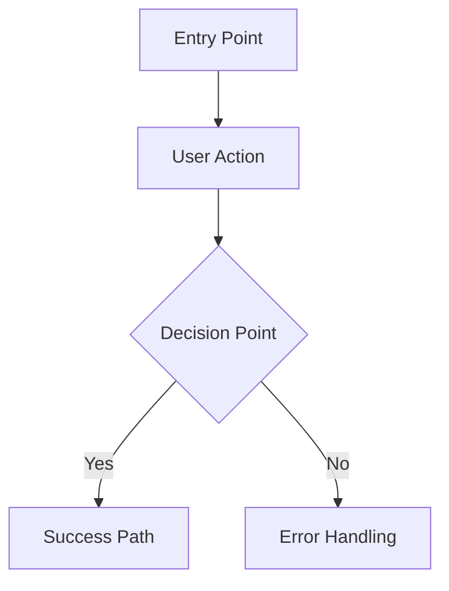

# FRD Structure & Template

> **Use this comprehensive template for creating production-grade FRDs.**

## Complete FRD Document Structure

```markdown
# Functional Requirements Document: [Product/Feature Name]

## Document Information
- **Author**: [Name]
- **Date**: [Date]
- **Version**: [Version number]
- **Status**: [Draft/In Review/Approved]
- **Last Updated**: [Date]
- **PRD Reference**: [Link to PRD]

---

## Executive Summary

### Overview
[1-2 paragraph summary of what this FRD covers]

### Scope
**In Scope**: [What's covered in this FRD]
**Out of Scope**: [What's explicitly not covered]

### Key Stakeholders
| Name | Role | Responsibility |
|------|------|----------------|
| [Name] | [Role] | [Responsibility] |

---

## 1. PRD Summary

### Product Vision
[From PRD - concise vision statement]

### Business Goals
1. [Goal 1 from PRD]
2. [Goal 2 from PRD]
3. [Goal 3 from PRD]

### Success Metrics
| Metric | Current | Target | Timeline |
|--------|---------|--------|----------|
| [Metric 1] | [Baseline] | [Target] | [Date] |

### User Personas
[Summary of primary personas from PRD]

---

## 2. User Roles & Permissions

### User Role Matrix

| Role | Description | Permissions | Access Level |
|------|-------------|-------------|--------------|
| **Guest** | Unauthenticated user | Browse public content, sign up | Public |
| **End User** | Authenticated user | [Specific permissions] | Standard |
| **Admin** | System administrator | Full system access | Admin |
| **Manager** | Supervisory role | [Specific permissions] | Elevated |

---

## 3. User Flows

### 3.1 Critical User Journeys

#### Journey 1: [Journey Name]
[Detailed user journey with steps, decisions, and outcomes]

### 3.2 User Flow Diagrams


---

## 4. Functional Requirements

### 4.1 Module: [Module Name]

#### FR-[MODULE]-001: [Requirement Title]

##### PRD Reference
[Link to PRD section/feature]

##### Business Goal
[Which business goal does this support?]

##### User Story
**As a** [user role]
**I want to** [action]
**So that** [benefit]

##### Description
[Detailed description of what the system must do]

##### User Role(s)
[Which roles can perform this action]

##### Input
- [Input 1]: [Data type, format, constraints]
- [Input 2]: [Data type, format, constraints]

##### Processing (Pseudo-Code / Logic)
> *Mandatory: Write in structured bullet points or pseudo-code that describes the logic clearly for the developer.*
1. [Logic Step 1: e.g., Verify if email exists in DB]
2. [Logic Step 2: e.g., If exists, return 409 Conflict]
3. [Logic Step 3: e.g., Else, hash password and store]

##### Output
- [Output 1]: [Data type, format]
- [Output 2]: [Data type, format]

##### Business Rules
- [Rule 1]
- [Rule 2]

##### Validation Rules
- [Validation 1]
- [Validation 2]

##### Error Handling
| Error Condition | Error Message | Recovery Action |
|-----------------|---------------|-----------------|
| [Condition] | [Message] | [Action] |

##### Dependencies
> *Mandatory: List all FR IDs that must be implemented before or alongside this requirement.*
- [FR-XXX-YYY]: [Description of dependency]

##### Priority
[P0/P1/P2/P3] (from PRD)

##### Cost of Inaction (P0 Required)
[Quantify revenue loss or security risk if deferred]

##### Acceptance Criteria


###### AC-001.1: [Happy Path Scenario]
```gherkin
Given [context]
When [action]
Then [expected result]
  And [additional outcome]
```

###### AC-001.2: [Error Scenario]
```gherkin
Given [context]
When [invalid action]
Then [error handling]
  And [recovery action]
```

---

## 5. Non-Functional Requirements

### 5.1 Performance Requirements
#### NFR-PERF-001: API Response Time
- **Requirement**: 95th percentile response time < 200ms for all API endpoints
- **Measurement**: Server-side latency from request to response
- **Validation**: Load testing with 1000 concurrent users

### 5.2 Scalability Requirements
#### NFR-SCALE-001: User Growth
- **Requirement**: System must support 10x user growth
- **Timeline**: 12 months
- **Validation**: Load testing at target capacity

### 5.3 Security Requirements
#### NFR-SEC-001: Authentication
- **Requirement**: Multi-factor authentication (MFA) for all accounts
- **Implementation**: TOTP-based MFA with backup codes
- **Validation**: Security audit and penetration testing

#### NFR-SEC-002: Data Encryption
- **Requirement**: All data encrypted at rest (AES-256) and in transit (TLS 1.3)
- **Validation**: Security scan and compliance audit

### 5.4 Reliability Requirements
#### NFR-REL-001: Availability
- **Requirement**: 99.9% uptime (< 8.76 hours downtime/year)
- **Measurement**: Uptime monitoring
- **Validation**: SLA tracking

#### NFR-REL-002: Disaster Recovery
- **Requirement**: RTO < 4 hours, RPO < 1 hour
- **Implementation**: Automated hourly backups, multi-region deployment
- **Validation**: Disaster recovery drills

### 5.5 Usability Requirements
#### NFR-USE-001: Accessibility
- **Requirement**: WCAG 2.1 Level AA compliance
- **Validation**: Automated accessibility testing + manual audit

#### NFR-USE-002: Browser Support
- **Requirement**: Latest 2 versions of Chrome, Firefox, Safari, Edge
- **Validation**: Cross-browser testing

### 5.6 Maintainability Requirements
#### NFR-MAINT-001: Code Quality
- **Requirement**: Maintainability Index > 80 (SonarQube)
- **Validation**: Static code analysis

#### NFR-MAINT-002: Test Coverage
- **Requirement**: Minimum 98% code coverage (lines, branches, functions) for unit tests
- **Validation**: Coverage reports in CI/CD pipeline

---

## 6. Data Requirements

### 6.1 Data Model
[High-level entity-relationship overview]

### 6.2 Data Entities

#### Entity: [Entity Name]
| Field | Type | Required | Validation | Description |
|-------|------|----------|------------|-------------|
| [field1] | [type] | Yes/No | [rules] | [description] |

### 6.3 Data Privacy & Security
- **PII Handling**: [Requirements for personal data]
- **Data Retention**: [Retention policies]
- **Data Access**: [Access control requirements]

---

## 7. Integration Requirements

### 7.1 External Systems

| System | Purpose | Integration Type | Data Flow | Authentication |
|--------|---------|------------------|-----------|----------------|
| [System 1] | [Purpose] | REST API | Inbound | OAuth 2.0 |

### 7.2 API Requirements

#### API: [API Name]
- **Endpoint**: [URL]
- **Method**: [GET/POST/PUT/DELETE]
- **Authentication**: [Type]
- **Request Format**: [JSON/XML]
- **Response Format**: [JSON/XML]
- **Rate Limiting**: [Limits]

---

## 8. UI/UX Requirements

### 8.1 User Interface Principles
- [Principle 1: e.g., Progressive disclosure]
- [Principle 2: e.g., Consistent navigation]

### 8.2 Key Screens
| Screen | Purpose | User Role(s) | Priority |
|--------|---------|--------------|----------|
| [Screen 1] | [Purpose] | [Roles] | P0 |

### 8.3 Interaction Patterns
- [Pattern 1: e.g., Inline validation]
- [Pattern 2: e.g., Optimistic UI updates]

---

## 9. Milestone Execution Plan

| Milestone | Phase | Key Features / FR-IDs | Duration | Success Criteria |
|-----------|-------|-----------------------|----------|------------------|
| **M1** | MVP | Auth (FR-001), core profile (FR-005) | 2 Weeks | User can login and update profile |
| **M2** | Core | Payment (FR-010), Search (FR-015) | 3 Weeks | Payments processed successfully |
| **M3** | Polish | Notifications, Reporting | 2 Weeks | Admin can download reports |

---

## 10. Technical Constraints

### 10.1 System Constraints
- **Platform**: [Web/Mobile/Desktop]
- **Browser Support**: [Browsers and versions]
- **Device Support**: [Devices]

### 10.2 Technology Constraints
- **Backend**: [Constraints - e.g., Node.js 22.x LTS]
- **Frontend**: [Constraints - e.g., React 18.x+]
- **Database**: [Constraints - e.g., PostgreSQL 16.x+]

### 10.3 Integration Constraints
- [Constraint 1: e.g., External API rate limits]
- [Constraint 2: e.g., Third-party service dependencies]

---

## 11. Assumptions & Dependencies

### 11.1 Assumptions
- [Assumption 1]
- [Assumption 2]

### 11.2 Dependencies
| Dependency | Type | Owner | Status |
|------------|------|-------|--------|
| [Dependency 1] | External API | [Team] | Available |

---

## 12. Risks & Mitigation

| Risk | Probability | Impact | Mitigation Strategy |
|------|-------------|--------|---------------------|
| [Risk 1] | High/Med/Low | High/Med/Low | [Strategy] |

---

## 13. Open Questions

- [ ] [Question 1]
- [ ] [Question 2]

---

## 14. Stakeholder Approval

| Stakeholder | Role | Status | Date | Comments |
|-------------|------|--------|------|----------|
| [Name] | Product Owner | ✅ Approved | [Date] | - |
| [Name] | Engineering Lead | ⏳ Pending | - | - |
| [Name] | Design Lead | ⏳ Pending | - | - |
| [Name] | QA Lead | ⏳ Pending | - | - |

---

## 15. Appendix

### 15.1 Glossary
- **Term 1**: [Definition]
- **Term 2**: [Definition]

### 15.2 References
- [Reference 1: Link to PRD]
- [Reference 2: Link to research]

### 15.3 Change Log
| Version | Date | Author | Changes |
|---------|------|--------|---------|
| 1.0 | [Date] | [Name] | Initial version |
```

## FRD File Organization

> **FRD outputs are co-located with PRD in AI_DOCS/planning/ for streamlined planning phase.**

```
AI_DOCS/
└── planning/
    ├── prd.md                          # Product Requirements (from prd-generation)
    ├── frd.md                          # Functional Requirements (main document)
    ├── PRD_ANALYSIS.md                 # PRD analysis summary
    ├── user-flows.md                   # Detailed user flow diagrams
    ├── acceptance-criteria.md          # Consolidated acceptance criteria
    └── TECHNICAL_FEASIBILITY.md        # Feasibility assessment
```

**Handoff**: `frd.md` becomes the primary input for `design-screens` and `build` skills.

## Writing Guidelines

| Guideline | Description |
|-----------|-------------|
| **Clear & Concise** | Use simple language, avoid jargon |
| **Specific** | Avoid vague terms; use measurable criteria |
| **Consistent** | Use consistent terminology throughout |
| **Structured** | Follow the defined template structure |
| **Traceable** | Link every requirement to PRD goals |
| **Visual** | Use diagrams, tables, and visuals to clarify |
