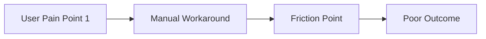
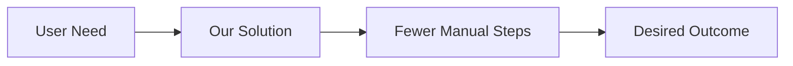

# PRD Document Structure & Template

> Extracted from [SKILL.md](SKILL.md) Section 7.1 — Complete PRD Document Structure

---

```markdown
# Product Requirements Document: [Product/Feature Name]

## Document Information
- **Author**: [Name]
- **Date**: [Date]
- **Version**: [Version number]
- **Status**: [Draft/In Review/Approved]
- **Last Updated**: [Date]
- **Stakeholders**: [List of key stakeholders]

---

## Executive Summary

### Problem Statement
**For** [target user]
**Who** [user need or pain point]
**The** [product name]
**Is a** [product category]
**That** [key benefit]
**Unlike** [alternatives]
**Our product** [unique differentiator]

### Product Vision
We envision a future where [target users] can [desired outcome]
without [current pain point], enabling them to [ultimate benefit].

### Business Goals
1. [Goal 1 with metric: e.g., Increase revenue by 30%]
2. [Goal 2 with metric: e.g., Reduce churn by 15%]
3. [Goal 3 with metric: e.g., Acquire 10,000 new users]

### Success Metrics
| Metric | Current | Target | Timeline |
|--------|---------|--------|----------|
| [Metric 1] | [Baseline] | [Target] | [Date] |
| [Metric 2] | [Baseline] | [Target] | [Date] |

---

## 1. Product Overview

### 1.1 Product Context
[Background: Why are we building this? What's the market opportunity?]

### 1.2 Target Audience
**Primary Users** (80%): [Description]
**Secondary Users** (20%): [Description]

### 1.3 Scope
**In Scope**:
- [Feature/capability 1]
- [Feature/capability 2]

**Out of Scope** (explicitly deferred):
- [Item 1]
- [Item 2]

---

## 2. User Research & Personas

### 2.1 Research Methodology
- **User Interviews**: [Number] interviews conducted
- **Surveys**: [Number] responses
- **Data Analysis**: [Analytics tools used]
- **Competitive Research**: [Competitors analyzed]

### 2.2 User Personas

#### Primary Persona: [Persona Name]
- **Demographics**: [Age, role, experience level]
- **Goals**: 
  - [Goal 1]
  - [Goal 2]
- **Pain Points**:
  - [Pain point 1]
  - [Pain point 2]
- **Behaviors**:
  - [Behavior 1]
  - [Behavior 2]
- **Quote**: "[Representative quote from user research]"

#### Secondary Persona: [Persona Name]
[Same structure as primary]

---

## 3. Competitive Analysis

### 3.1 Market Landscape

| Competitor | Strengths | Weaknesses | Market Share | Pricing |
|------------|-----------|------------|--------------|---------|
| [Competitor 1] | [Strengths] | [Weaknesses] | [%] | [$] |
| [Competitor 2] | [Strengths] | [Weaknesses] | [%] | [$] |

### 3.2 Feature Comparison Matrix

| Feature | Us | Competitor 1 | Competitor 2 | Competitive Advantage |
|---------|----|--------------|--------------|-----------------------|
| [Feature 1] | ✅ | ✅ | ❌ | Parity |
| [Feature 2] | ✅ | ❌ | ❌ | **Differentiator** |

### 3.3 Our Unique Value Proposition
[What makes our solution uniquely valuable compared to alternatives?]

---

## 4. User Journeys

### 4.1 Current User Journey (Before)


### 4.2 Proposed User Journey (After)


### 4.3 Critical User Workflows

#### Workflow 1: [Workflow Name]
**User Goal**: [What user wants to achieve]
**Steps**:
1. [Step 1] - [System response]
2. [Step 2] - [System response]
3. [Step 3] - [System response]

**Pain Points Addressed**:
- [Pain point 1] → [How we solve it]
- [Pain point 2] → [How we solve it]

---

## 5. Functional Requirements

### 5.1 Feature: [Feature Name]

#### User Stories

##### Story 1: [Story Title]
**As a** [user role]
**I want to** [action]
**So that** [benefit]

**Acceptance Criteria**:
- [ ] Given [context], when [action], then [expected result]
- [ ] Given [context], when [action], then [expected result]

**Priority**: [Must/Should/Could/Won't]
**Effort Estimate**: [Story points]
**Dependencies**: [Dependency list]

---

## 6. Non-Functional Requirements

### 6.1 Performance
- **Response Time**: < 200ms (p95)
- **Throughput**: 1000 requests/second
- **Concurrent Users**: 10,000 simultaneous users

### 6.2 Scalability
- **User Growth**: Support 10x growth (10K → 100K users) in 12 months
- **Data Volume**: Handle 1TB data with linear scaling

### 6.3 Security
- **Authentication**: Multi-factor authentication (MFA) required
- **Authorization**: Role-based access control (RBAC)
- **Compliance**: GDPR, SOC 2 Type II, HIPAA (if applicable)

### 6.4 Reliability
- **Availability**: 99.9% uptime (< 8.76 hours downtime/year)
- **Disaster Recovery**: RTO < 4 hours, RPO < 1 hour

### 6.5 Usability
- **Accessibility**: WCAG 2.1 Level AA compliance
- **Browser Support**: Latest 2 versions of Chrome, Firefox, Safari, Edge
- **Localization**: English, Spanish, French (Phase 1)

---

## 7. Success Metrics & KPIs

### 7.1 Business Metrics
| Metric | Baseline | Target | Measurement Method |
|--------|----------|--------|--------------------|
| Revenue | [$X] | [$Y] | Sales data |
| Customer Acquisition Cost (CAC) | [$X] | [$Y] | Marketing spend / new customers |
| Lifetime Value (LTV) | [$X] | [$Y] | Revenue per customer |

### 7.2 Product Metrics
| Metric | Baseline | Target | Measurement Method |
|--------|----------|--------|--------------------|
| Monthly Active Users (MAU) | [X] | [Y] | Analytics |
| Day 7 Retention | [X%] | [Y%] | Cohort analysis |
| Time to First Value | [X min] | [Y min] | User tracking |

### 7.3 Feature Adoption Metrics
| Metric | Target | Measurement Method |
|--------|--------|--------------------|
| Feature Adoption Rate | 60% of active users | Feature usage tracking |
| Feature Usage Frequency | 3x per week | Event tracking |
| User Satisfaction (CSAT) | 4.5/5.0 | In-app surveys |

---

## 8. Feature Prioritization & Roadmap

### 8.1 Prioritization Matrix

| Feature | User Impact | Business Value | Effort | Priority | Phase |
|---------|-------------|----------------|--------|----------|-------|
| [Feature 1] | High | High | Low | **Must Have** | v1.0 |
| [Feature 2] | High | Medium | Medium | Should Have | v1.0 |
| [Feature 3] | Medium | High | High | Should Have | v1.1 |
| [Feature 4] | Low | Low | Low | Could Have | v2.0 |

### 8.2 Release Roadmap

#### v1.0 - MVP (Target: [Date])
**Goal**: [Launch goal]
**Must-Have Features**:
- [Feature 1]
- [Feature 2]
**Success Criteria**:
- [Metric 1]: [Target]
- [Metric 2]: [Target]

#### v1.1 - Enhancement (Target: [Date])
**Goal**: [Enhancement goal]
**Should-Have Features**:
- [Feature 3]
- [Feature 4]

#### v2.0 - Major Update (Target: [Date])
**Goal**: [Long-term vision]
**Future Features**:
- [Feature 5]
- [Feature 6]

---

## 9. Risks & Mitigation

| Risk | Probability | Impact | Mitigation Strategy | Owner |
|------|-------------|--------|---------------------|-------|
| [Risk 1] | High/Med/Low | High/Med/Low | [Strategy] | [Name] |
| [Risk 2] | High/Med/Low | High/Med/Low | [Strategy] | [Name] |

---

## 10. Assumptions & Dependencies

### 10.1 Assumptions
- [Assumption 1]
- [Assumption 2]

### 10.2 Dependencies
| Dependency | Type | Owner | Status | Risk if Delayed |
|------------|------|-------|--------|-----------------|
| [External API] | Technical | [Team] | Available | High |
| [Design System] | Design | [Team] | In Progress | Medium |

---

## 11. Open Questions

- [ ] [Question 1 requiring stakeholder decision]
- [ ] [Question 2 requiring research]
- [ ] [Question 3 requiring technical validation]

---

## 12. Stakeholder Approval

| Stakeholder | Role | Status | Date | Comments |
|-------------|------|--------|------|----------|
| [Name] | Product Owner | ✅ Approved | [Date] | - |
| [Name] | Engineering Lead | ⏳ Pending | - | - |
| [Name] | Design Lead | ⏳ Pending | - | - |
| [Name] | Business Owner | ⏳ Pending | - | - |

---

## 13. Appendix

### 13.1 Research Data
[Links to user interviews, surveys, analytics dashboards]

### 13.2 Glossary
- **Term 1**: [Definition]
- **Term 2**: [Definition]

### 13.3 Change Log
| Version | Date | Author | Changes |
|---------|------|--------|---------|
| 1.0 | [Date] | [Name] | Initial version |
| 1.1 | [Date] | [Name] | [Changes] |
```
