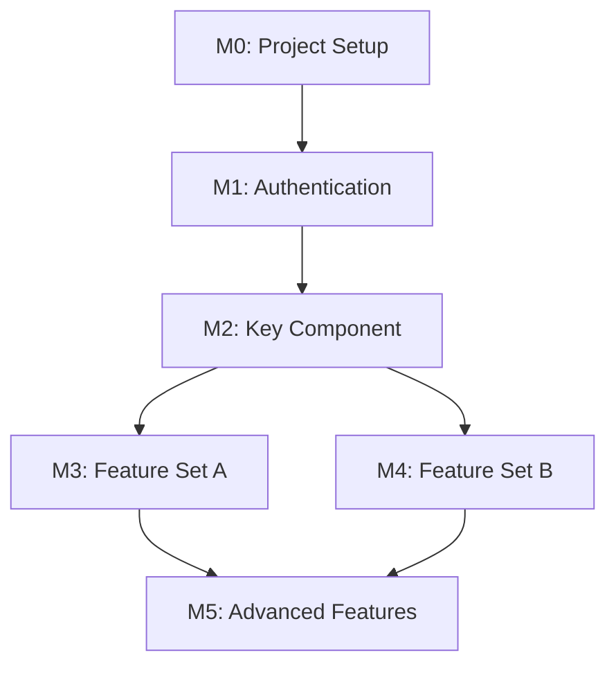

# Process Reference (Philosophy, Depth, Output Layout, Worked Examples)

> Extracted from [SKILL.md](SKILL.md): the core philosophy table, the project-type depth table, the AI_DOCS output layout, the full Given-When-Then example, and the Phase F6.5 dependency-graph example.

---

## Core Philosophy (Section 1.2)

| Principle | Description |
|-----------|-------------|
| **User-Centered Thinking** | Every product decision must solve a real user problem with measurable impact |
| **Data-Driven Decisions** | Base decisions on evidence, not opinions or assumptions |
| **Strategic Vision** | Connect every feature to business goals and long-term product vision |
| **Stakeholder Alignment** | Ensure all stakeholders (business, users, engineering) are aligned |
| **Iterative Delivery** | Ship value early and often, learn from users, iterate |

## Project Type Depth (Section 6)

| Type | Research | Documentation | Roadmap | Timeline |
|------|----------|---------------|---------|----------|
| **POC** | Lightweight (2-3 user interviews) | 1-2 pages | Single milestone | 1-4 weeks |
| **MVP** | Moderate (5-10 user interviews) | 5-10 pages | 2-3 milestones (v1.0, v1.1) | 2-3 months |
| **Production-Grade** | Comprehensive (10-20 user interviews) | 15-30+ pages | Multi-phase roadmap (v1.0, v1.1, v2.0) | 3-12+ months |

## AI_DOCS Output Layout (Section 8)

```
AI_DOCS/
└── planning/
    ├── prd.md                    # Main product requirements document
    ├── PRD_ANALYSIS.md           # Discovery summary (optional)
    ├── COMPETITIVE_ANALYSIS.md   # Competitor research (optional)
    └── USER_RESEARCH.md          # User interviews, personas (optional)
```

## Given-When-Then Full Example (Section 10.1.2)

  ```
  Given: User has a registered account
  When: User enters valid credentials and clicks Login
  Then: User is redirected to dashboard
    And: Welcome message is displayed
    And: User session is created
  ```

## Phase F6.5 Dependency Graph Example


