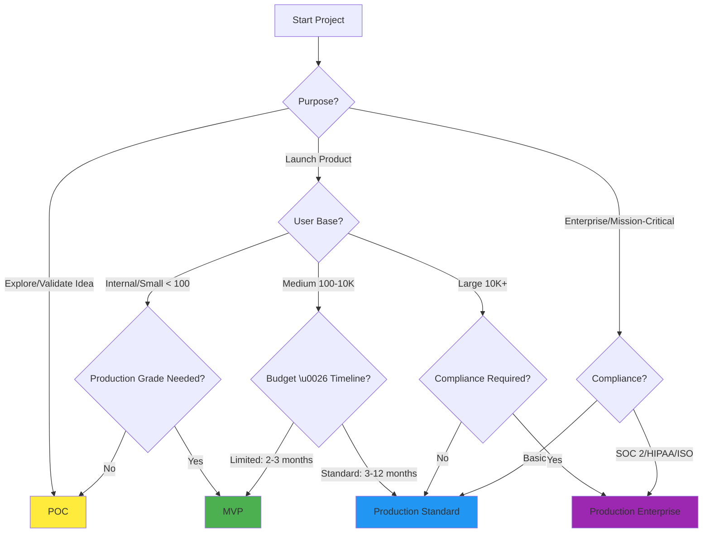

# Project Types Guide

> **Purpose**: Define project type classifications and guide selection based on requirements  
> **Audience**: Product managers, engineering leads, business stakeholders

---

## 🚨 Initialization & Memory Logic
> [!NOTE]
> **Gated Approach**: Memory initialization handled by [session-management](../session-management/SKILL.md). Gate status checked before skill handoff.

---

## Overview

This document defines four project type classifications (POC, MVP, Production-Grade Standard, Production-Grade Enterprise) and provides guidance on selecting the appropriate type based on your requirements, timeline, budget, and quality expectations.

**Why Project Types Matter**:
- Different types require different levels of rigor
- Helps set realistic expectations for timeline and cost
- Guides quality standards and testing requirements
- Determines what deliverables are needed

---

## Project Type Definitions

### POC (Proof of Concept)

**Purpose**: Validate technical feasibility or explore new technology

**Characteristics**:
- ⏱️ **Timeline**: 1-4 weeks
- 👥 **Team Size**: 1-2 developers
- 📊 **Complexity**: Single feature or limited functionality
- 🎯 **Goal**: Answer "Can we build this?" or "Does this approach work?"

**Quality Standards**:
| Aspect | Requirement |
|--------|-------------|
| **Testing** | 98%+ unit tests (lines, branches, functions) + manual exploratory |
| **Documentation** | README only (setup + usage) |
| **Code Quality** | Working code, may have technical debt |
| **Uptime/SLA** | N/A (not production-ready) |
| **Security** | Basic (no sensitive data) |
| **Scalability** | N/A (not for scale) |

**Deliverables**:
- ✅ Working prototype
- ✅ 98%+ unit test coverage (lines, branches, functions)
- ✅ Basic README documentation
- ✅ Feasibility report (what worked, what didn't)
- ❌ No production deployment
- ❌ No API documentation

**When to Use POC**:
- ✅ Evaluating new technology or framework
- ✅ Validating technical approach before commitment
- ✅ Internal proof that concept is viable
- ✅ Quick experiment (throwaway code acceptable)

**When NOT to Use POC**:
- ❌ External customer-facing product
- ❌ Production deployment needed
- ❌ Long-term maintenance required
- ❌ Security or compliance requirements

---

### MVP (Minimum Viable Product)

**Purpose**: Launch quickly with core features to validate product-market fit

**Characteristics**:
- ⏱️ **Timeline**: 2-3 months
- 👥 **Team Size**: 3-5 developers
- 📊 **Complexity**: Core features only, limited scope
- 🎯 **Goal**: Get to market fast, learn from real users

**Quality Standards**:
| Aspect | Requirement |
|--------|-------------|
| **Testing** | 98%+ unit tests (lines, branches, functions), critical APIs tested, critical flows E2E tested |
| **Documentation** | API docs + User guide + README |
| **Code Quality** | Clean code, limited technical debt |
| **Uptime/SLA** | 95% uptime (some downtime acceptable) |
| **Security** | Standard security (authentication, authorization, input validation) |
| **Scalability** | Supports initial user base (100-1000 users) |

**Deliverables**:
- ✅ Lightweight `prd.md` (5-10 pages)
- ✅ Detailed `frd.md` (50-100 requirements)
- ✅ 10-15 screens (if design stage included)
- ✅ Working backend + frontend
- ✅ 98%+ unit test coverage (lines, branches, functions)
- ✅ Critical API integration tests
- ✅ Critical user flow E2E tests
- ✅ API documentation (Swagger/OpenAPI)
- ✅ Basic user guide

**When to Use MVP**:
- ✅ Testing product-market fit
- ✅ Launching to early adopters
- ✅ Need to get feedback quickly
- ✅ Limited budget but need production-ready product

**When NOT to Use MVP**:
- ❌ Enterprise customers with high expectations
- ❌ Strict compliance requirements (HIPAA, SOC 2)
- ❌ Mission-critical applications (downtime unacceptable)
- ❌ Large-scale rollout (10K+ users)

---

### Production-Grade (Standard)

**Purpose**: Launch a reliable, scalable, maintainable product for general production use

**Characteristics**:
- ⏱️ **Timeline**: 3-6 months (single product) or 6-12 months (complex multi-app)
- 👥 **Team Size**: 5-10 developers
- 📊 **Complexity**: Full feature set, multiple user roles
- 🎯 **Goal**: Production-ready system with high quality standards

**Quality Standards**:
| Aspect | Requirement |
|--------|-------------|
| **Testing** | 98%+ unit tests (lines, branches, functions), 100% API coverage, top 20 flow E2E tests, load testing, security testing |
| **Documentation** | Complete (`prd.md`, `frd.md`, architecture, API, user docs, operational runbook) |
| **Code Quality** | SonarQube Quality Gate PASS, zero critical/blocker issues |
| **Uptime/SLA** | 99.5% uptime (< 43.8 hours downtime/year) |
| **Security** | Zero critical/high vulnerabilities, automated security scanning |
| **Scalability** | Supports 1K-10K users, horizontal scaling supported |

**Deliverables**:
- ✅ Comprehensive `prd.md` (15-30+ pages, 10-20 user interviews)
- ✅ Complete `frd.md` (100-300+ requirements with Given-When-Then AC)
- ✅ Full design system (30-100+ screens, if design stage included)
- ✅ Production-grade backend + frontend (SonarQube PASS)
- ✅ 98%+ unit test coverage (lines, branches, functions)
- ✅ 100% API integration test coverage
- ✅ Top 20 user flows E2E automated tests
- ✅ Load testing (validates at 2x expected load)
- ✅ Security testing (OWASP ZAP, Snyk, zero critical/high vulnerabilities)
- ✅ Complete API documentation (Swagger/OpenAPI)
- ✅ Architecture documentation (diagrams, ERD, sequence diagrams)
- ✅ User documentation + admin documentation
- ✅ Operational runbook

**When to Use Production-Grade Standard**:
- ✅ Customer-facing production application
- ✅ Business-critical systems
- ✅ Expected user base: 1K-10K users
- ✅ Uptime is important (99.5% SLA acceptable)
- ✅ Standard security requirements

**When NOT to Use Production-Grade Standard**:
- ❌ POC or quick experiment
- ❌ Enterprise compliance needed (SOC 2, HIPAA, ISO 27001)
- ❌ Mission-critical (99.99% uptime required)
- ❌ Very large scale (100K+ users)

---

### Production-Grade (Enterprise)

**Purpose**: Launch an enterprise-grade, highly reliable, compliant system for mission-critical use

**Characteristics**:
- ⏱️ **Timeline**: 6-12+ months
- 👥 **Team Size**: 10-20+ developers
- 📊 **Complexity**: Full enterprise feature set, complex workflows, multi-tenancy
- 🎯 **Goal**: Mission-critical, highly available, compliant system

**Quality Standards (Includes all Standard + additional)**:
| Aspect | Requirement |
|--------|-------------|
| **Testing** | **98%+ unit tests (lines, branches, functions)**, full test suite (unit, integration, E2E, load, chaos engineering), compliance testing |
| **Documentation** | Complete + compliance documentation (audit logs, security policies) |
| **Code Quality** | SonarQube Quality Gate PASS, Maintainability Rating A, zero technical debt > 5% |
| **Uptime/SLA** | **99.9%+ uptime** (< 8.76 hours downtime/year) |
| **Security** | Penetration testing, SAST/DAST, audit logging for all sensitive operations, compliance (SOC 2, HIPAA, ISO 27001) |
| **Scalability** | Supports 10K-1M+ users, auto-scaling, multi-region deployment |
| **Disaster Recovery** | RTO < 4 hours, RPO < 1 hour, automated backups, DR drills |

**Deliverables (Includes all Standard + additional)**:
- All Production-Grade Standard deliverables +
- ✅ 98%+ unit test coverage (lines, branches, functions)
- ✅ Chaos engineering tests (system resilient to failures)
- ✅ Compliance testing (SOC 2, HIPAA, GDPR as applicable)
- ✅ Disaster recovery plan + DR drills
- ✅ Penetration testing report
- ✅ Audit logging for all sensitive operations
- ✅ Multi-region deployment architecture
- ✅ Auto-scaling configuration
- ✅ Compliance documentation (security policies, audit logs)

**When to Use Production-Grade Enterprise**:
- ✅ Enterprise customers (Fortune 500, government)
- ✅ Mission-critical applications (downtime = revenue loss)
- ✅ Compliance required (SOC 2, HIPAA, ISO 27001, GDPR)
- ✅ Large scale (10K-1M+ users)
- ✅ 99.9%+ uptime SLA required
- ✅ Multi-tenancy or multi-region deployment

**When NOT to Use Production-Grade Enterprise**:
- ❌ Startup MVP (over-engineering)
- ❌ Internal tools (not customer-facing)
- ❌ Limited budget (enterprise is expensive)
- ❌ Small user base (< 1K users)

---

## Project Type Comparison Matrix

| Criteria | POC | MVP | Production Standard | Production Enterprise |
|----------|-----|-----|---------------------|------------------------|
| **Timeline** | 1-4 weeks | 2-3 months | 3-12 months | 6-12+ months |
| **Team Size** | 1-2 | 3-5 | 5-10 | 10-20+ |
| **PRD Pages** | None or 1-2 | 5-10 | 15-30+ | 30-50+ |
| **FRD Requirements** | 10-20 (high-level) | 50-100 | 100-300+ | 300-1000+ |
| **Screens** | 1-3 | 10-15 | 30-100+ | 100-300+ |
| **Unit Test Coverage** (lines, branches, functions) | 98%+ | 98%+ | 98%+ | 98%+ |
| **API Test Coverage** | 0% (manual) | Critical APIs | 100% | 100% |
| **E2E Test Coverage** | 0% (manual) | Critical flows | Top 20 flows | All critical flows |
| **Additional Testing** | None | Basic security | Load + Security | Load + Security + Chaos + Compliance |
| **Uptime SLA** | N/A | 95% | 99.5% | 99.9%+ |
| **User Capacity** | N/A | 100-1K | 1K-10K | 10K-1M+ |
| **Security Level** | Basic | Standard | High | Enterprise |
| **Compliance** | None | None | Optional | Required (SOC 2, HIPAA, etc.) |
| **Disaster Recovery** | None | None | Basic backups | RTO < 4hr, RPO < 1hr |

---

## Decision Framework: Choosing the Right Project Type

### Decision Tree



### Key Questions to Ask

1. **What is the primary purpose?**
   - Explore idea/validate tech → **POC**
   - Launch to early adopters → **MVP** (requires `frd.md`)
   - Launch to customers → **Production Standard**
   - Enterprise/mission-critical → **Production Enterprise**

2. **What is the expected user base?**
   - < 100 users → **POC or MVP**
   - 100-1K users → **MVP**
   - 1K-10K users → **Production Standard**
   - 10K+ users → **Production Enterprise**

3. **What is the acceptable downtime?**
   - N/A (not production) → **POC**
   - 5% downtime OK (18 days/year) → **MVP**
   - 0.5% downtime max (43.8 hours/year) → **Production Standard**
   - 0.1% downtime max (8.76 hours/year) → **Production Enterprise**

4. **Are there compliance requirements?**
   - No → **POC, MVP, or Production Standard**
   - Yes (SOC 2, HIPAA, ISO 27001, GDPR) → **Production Enterprise**

5. **What is the budget and timeline?**
   - 1-4 weeks, minimal budget → **POC**
   - 2-3 months, moderate budget → **MVP**
   - 3-12 months, standard budget → **Production Standard**
   - 6-12+ months, enterprise budget → **Production Enterprise**

---

## Transitioning Between Project Types

It's common to start with a lower tier and upgrade later:

### POC → MVP
**When**: POC validated technical feasibility, now ready to launch to users

**Changes Required**:
- Keep the 98%+ unit coverage floor (lines, branches, functions) as scope grows; add integration + E2E tests
- Add API documentation
- Improve code quality (reduce technical debt)
- Set up production environment
- Add monitoring and alerting

### MVP → Production Standard
**When**: MVP found product-market fit, scaling to larger user base

**Changes Required**:
- Keep unit test coverage at the 98%+ floor (lines, branches, functions) as scope grows
- Add 100% API integration tests
- Add E2E tests for top 20 flows
- Add load testing
- Add security testing (OWASP ZAP, Snyk)
- Improve uptime (95% → 99.5%)
- Add complete documentation

### Production Standard → Production Enterprise
**When**: Enterprise customers require compliance and higher SLAs

**Changes Required**:
- Keep unit test coverage at the 98%+ floor (lines, branches, functions); add mutation testing for depth
- Add chaos engineering tests
- Add compliance testing (SOC 2, HIPAA, etc.)
- Add penetration testing
- Add audit logging for sensitive operations
- Add disaster recovery (RTO/RPO validation)
- Add multi-region deployment
- Improve uptime (99.5% → 99.9%+)

---

## Cost and Effort Estimates

| Transition | Effort Multiplier | Example: If POC = 2 weeks |
|------------|-------------------|---------------------------|
| **POC → MVP** | 4-6x | MVP = 8-12 weeks |
| **MVP → Production Standard** | 2-3x | Standard = 6-9 months (from MVP) |
| **Production Standard → Enterprise** | 1.5-2x | Enterprise = 9-18 months (from Standard) |
| **POC → Production Standard** | 10-15x | Standard = 20-30 weeks (from scratch) |
| **POC → Production Enterprise** | 15-25x | Enterprise = 30-50 weeks (from scratch) |

---

## Summary

Choose your project type based on:
1. **Purpose**: Explore, Launch, Scale, or Enterprise
2. **User Base**: < 100, 100-1K, 1K-10K, or 10K+
3. **SLA Requirements**: N/A, 95%, 99.5%, or 99.9%+
4. **Compliance**: None or Required (SOC 2, HIPAA, ISO)
5. **Budget & Timeline**: 1-4 weeks, 2-3 months, 3-12 months, or 6-12+ months

**Golden Rule**: Start with the minimum viable type that meets your requirements. You can always upgrade later.

## Output: record the classification

Once the type is chosen, write `AI_DOCS/planning/project-classification.md`. `design-discovery`, `design-tokens`, `accessibility-audit`, `deployment-planning`, `milestone-validation` and `rules/design-rules.md` all read this file, and no other skill writes it. Keep it to these fields:

```markdown
# Project Classification

- Project type: POC | MVP | Production-Grade (Standard) | Production-Grade (Enterprise)
- Surface: web | mobile | web+mobile | api-only | cli
- Design classification: one or more of data-dashboard, consumer-app, stats-heavy, fintech, analytics, dev-tool, cli-adjacent-admin, minimal-utility, internal-only
- Domain: one of ecommerce, edtech, enterprise, fintech, gaming, government, healthcare, logistics, media, social, or none
- enforce_design_minimums: true | false
- Decided: <YYYY-MM-DD>, by <who confirmed it>
```

The design classification decides whether the minimums in `rules/design-rules.md` block or only warn. Set `enforce_design_minimums: true` only when a minimal-aesthetic project opts in to full enforcement. Update the file when the project moves to another type (see "Transitioning Between Project Types"), and record the change in `AI_DOCS/memory/decision-log.md`.

## Rules Integration
> - `.claude/rules/development-rules.md` — standards vary by project type (POC lighter, Production strict)
> - `.claude/rules/testing-rules.md` — coverage targets vary by project type
> - `.claude/rules/security-rules.md` — security rigor varies by project type

---

*Part of AI_SKILLS Framework v2.0*

## Next Step
Proceed to the next skill in the workflow as indicated in the YAML frontmatter.
