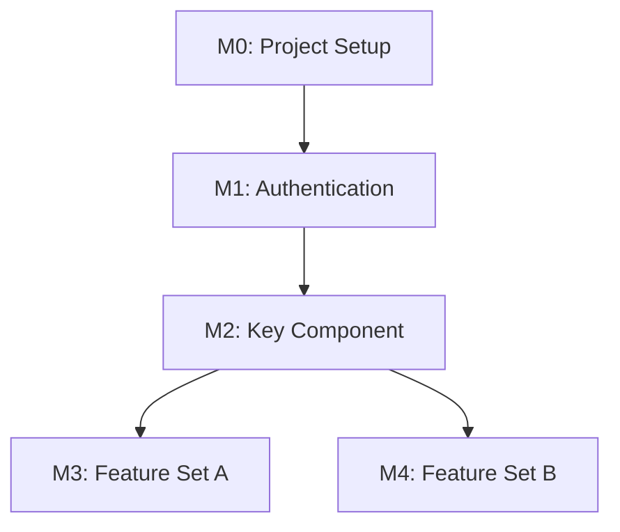

# Living Implementation Plan Template

> **Purpose**: This template defines the structure for `AI_DOCS/implementation-plan.md` - the AI's context memory with FILE REFERENCES, not duplicated content.
> **Location**: Created as `AI_DOCS/implementation-plan.md` during project initialization
> **Companion**: `AI_DOCS/task.md` (execution checklist)

---

## Document Metadata

| Key | Value |
|-----|-------|
| **Version** | 1.0.0 |
| **Created** | [ISO Date] |
| **Last Updated** | [ISO Date] |
| **Last Editor** | [AI / Username] |

---

## 1. Project Context

> [!TIP]
> **AI**: Use file:// links to load specific sections. DO NOT duplicate content here.

| Attribute | Value | Source |
|-----------|-------|--------|
| **Product Name** | [Name] | [prd.md#L10](file:///AI_DOCS/planning/prd.md#L10) |
| **Project Type** | [POC / MVP / Production-Grade] | [prd.md#L15](file:///AI_DOCS/planning/prd.md#L15) |
| **Current Stage** | [PRD / FRD / Design / Development / Deployment] | |
| **Tech Stack** | [Stack Summary] | [Section 2.1 below](#21-technology-selection) |

---

## 2. Key Document References

> [!IMPORTANT]
> **AI**: Click links to load specific sections. DO NOT duplicate content here.

### 2.1 Technology Selection

> Recorded from Technology Selection Wizard (technology-standards.md Section 0)

| Category | Selection | Rationale |
|----------|-----------|-----------|
| Backend | Option [A/B/C]: [Name] | [Why this choice] |
| Database | Option [A/B/C]: [Name] | [Why this choice] |
| Frontend | Option [A/B/C]: [Name] | [Why this choice] |
| Styling | Option [A/B/C]: [Name] | [Why this choice] |
| Auth | Option [A/B/C]: [Name] | [Why this choice] |

### 2.2 Active MCP Servers

> Recorded from MCP Server Configuration (session-management Step 1.6)
> See [mcp-server-recommendations.md](mcp-connector/templates/mcp-server-recommendations.md) for full catalog.

| Server | Status | Primary Use |
|--------|--------|-------------|
| `mongodb-mcp-server` | ✅ / ❌ | Database queries |
| `shadcn` | ✅ / ❌ | Component management |
| `next-devtools` | ✅ / ❌ | Next.js diagnostics |
| `mui-mcp-server` | ✅ / ❌ | MUI documentation |
| `gmp-code-assist` | ✅ / ❌ | Maps API guidance |

**Connection Details** (if applicable):
- MongoDB: `mongodb://[connection-string]`

### 2.3 Planning Documents

| Document | Purpose | Link |
|----------|---------|------|
| PRD | Product Requirements | [prd.md](file:///AI_DOCS/planning/prd.md) |
| FRD | Functional Requirements | [frd.md](file:///AI_DOCS/planning/frd.md) |
| Milestone Plan | Execution roadmap | [milestone-plan.md](file:///AI_DOCS/planning/milestone-plan.md) |
| Traceability Matrix | PRD → FRD → Task mapping | [Section 3 below](#3-requirement-traceability-matrix) |

### 2.4 Critical Sections (Quick Access)

| Section | Link | Description |
|---------|------|-------------|
| User Roles | [prd.md#L100-L150](file:///AI_DOCS/planning/prd.md#L100-L150) | Role definitions and permissions |
| Tech Stack Decision | [frd.md#L50-L80](file:///AI_DOCS/planning/frd.md#L50-L80) | Technology choices with rationale |
| Security Requirements | [frd.md#L200-L250](file:///AI_DOCS/planning/frd.md#L200-L250) | RBAC, authentication rules |
| API Contract | [api-contract.md](file:///AI_DOCS/architecture/api-contract.md) | OpenAPI/Swagger spec |
| Database Schema | [database-schema.md](file:///AI_DOCS/architecture/database-schema.md) | ERD and table definitions |
| Design Tokens | [design-tokens.md](file:///AI_DOCS/design/design-tokens.md) | Colors, typography, spacing |

---

## 3. Requirement Traceability Matrix

> [!IMPORTANT]
> **Links to source documents, not copied content.**

| PRD Feature | FRD Requirements | Milestone | Design Tasks | Dev Tasks |
|-------------|------------------|-----------|--------------|-----------|
| F-AUTH-001: User Authentication | FR-AUTH-001, FR-AUTH-002 | M1 | T-M1-01, T-M1-02 | T-M1-01, T-M1-02 |
| F-DASH-001: Dashboard | FR-DASH-001, FR-DASH-002 | M2 | T-M2-01 | T-M2-01 |

### Source Links

| ID | PRD Link | FRD Link |
|----|----------|----------|
| F-AUTH-001 | [prd#L120](file:///AI_DOCS/planning/prd.md#L120) | [frd#L80](file:///AI_DOCS/planning/frd.md#L80) |
| F-DASH-001 | [prd#L150](file:///AI_DOCS/planning/prd.md#L150) | [frd#L120](file:///AI_DOCS/planning/frd.md#L120) |

---

## 4. Milestone Structure

> **Reference Only** - Full details in [milestone-plan.md](file:///AI_DOCS/planning/milestone-plan.md)

| # | Name | Depends On | Status | Key Files |
|---|------|------------|--------|-----------|
| M0 | Project Setup | None | ⬜ Pending | [milestone-plan.md#L20](file:///AI_DOCS/planning/milestone-plan.md#L20) |
| M1 | Authentication | M0 | ⬜ Pending | [milestone-plan.md#L50](file:///AI_DOCS/planning/milestone-plan.md#L50) |
| M2 | [Key Component] | M1 | ⬜ Pending | [milestone-plan.md#L80](file:///AI_DOCS/planning/milestone-plan.md#L80) |
| M3 | [Features needing M2] | M2 | ⬜ Pending | [milestone-plan.md#L110](file:///AI_DOCS/planning/milestone-plan.md#L110) |

### Dependency Graph

---

## 5. Files Created/Modified

> **Track all implementation files for easy reference**

### 5.1 Design Files

| File Path | Task | Status |
|-----------|------|--------|
| `AI_DOCS/design/src/app/login/page.tsx` | T-M1-01 | ⬜ Pending |
| `AI_DOCS/design/src/components/ui/button.tsx` | T-M0-01 | ⬜ Pending |

### 5.2 Code Files

| File Path | Task | Status | Has Doc Header |
|-----------|------|--------|----------------|
| `src/auth/auth.service.ts` | T-M1-01 | ⬜ Pending | ⬜ |
| `src/app/login/page.tsx` | T-M1-01 | ⬜ Pending | ⬜ |

### 5.3 Test Files

| File Path | Task | Coverage |
|-----------|------|----------|
| `src/auth/__tests__/auth.service.spec.ts` | T-M1-01 | 0% |

---

## 6. Key Decisions Log

> [!NOTE]
> **Document important decisions made during the project.**

| ID | Date | Decision | Rationale | Alternatives Considered |
|----|------|----------|-----------|-------------------------|
| D-001 | [Date] | [Decision made] | [Why this choice] | [Other options] |

---

## 7. Open Questions

| ID | Question | Status | Assigned To | Resolved | Answer |
|----|----------|--------|-------------|----------|--------|
| Q-001 | [Question text] | 🔴 Open | [Name/AI] | - | - |

---

## 8. Risks & Blockers

| ID | Type | Description | Impact | Mitigation | Status |
|----|------|-------------|--------|------------|--------|
| R-001 | Risk | [Description] | [High/Medium/Low] | [Mitigation plan] | 🟡 Active |
| B-001 | Blocker | [Description] | [Impact] | [Resolution needed] | 🔴 Blocked |

---

## 9. Changelog

> [!NOTE]
> **Append-only log. Never delete entries.**

| Version | Date | Author | Changes |
|---------|------|--------|---------|
| 1.0.0 | [Date] | AI | Initial creation |
| 1.1.0 | [Date] | AI | PRD completed, tech stack selected |
| 1.2.0 | [Date] | AI | FRD completed, milestones defined |

---

## 10. Session Restore Instructions

> [!TIP]
> **AI**: When starting a new session, follow these steps:

1. **Read `AI_DOCS/task.md`** first - Get execution checklist and next action
2. **Read this file** - Get context, file references, decisions
3. **Load linked files** - Use file:// paths to load relevant documents
4. **Check Section 7 & 8** - Review open questions and blockers
5. **Resume work** - Continue from "Next Action" in task.md
6. **Update both files** - After completing any milestone

### Quick Links for Session Start

| Document | Purpose |
|----------|---------|
| [task.md](file:///AI_DOCS/task.md) | Execution checklist |
| [prd.md](file:///AI_DOCS/planning/prd.md) | Product requirements |
| [frd.md](file:///AI_DOCS/planning/frd.md) | Functional requirements |
| [milestone-plan.md](file:///AI_DOCS/planning/milestone-plan.md) | Current milestones |

---

*Part of AI_SKILLS Framework*
*Template Version: 1.0.0*
