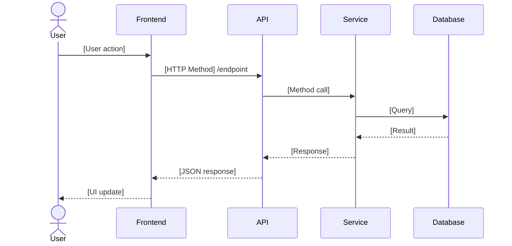

# Section Templates

> Extracted from [SKILL.md](SKILL.md) — content format templates for each of the 23 sections.

---

### Section 1: Problem Definition

```markdown
## 1. Problem Definition

**Objective**: [1-2 sentence description of what this system does]

**Business Context**: [Why this exists, what problem it solves]

**Success Metrics** (measurable):
- [Metric 1: e.g., Report generates in < 2 seconds]
- [Metric 2: e.g., Zero navigation errors reported post-launch]
```

---

### Section 2: Scope

```markdown
## 2. Scope

### Included
- [Feature 1]
- [Feature 2]

### Explicitly Excluded
- [Non-feature 1 — do NOT implement]
- [Non-feature 2 — out of scope for this version]
```

---

### Section 3: User Roles & Permissions

```markdown
## 3. User Roles & Permissions

| Role | Permissions |
|------|-------------|
| [Role 1] | [List of allowed actions] |
| [Role 2] | [List of allowed actions] |

**RBAC Type**: [Dynamic (DB-driven) / Static (code-level)]
```

---

### Section 4: User Flow

```markdown
## 4. User Flow

### [Flow Name] — [Role]

**Happy Path:**
1. [Step 1]
2. [Step 2]
...

**Edge Paths:**
- [What happens if user does X instead]

**Error Paths:**
- [What happens if API fails]
- [What happens if data is missing]

**Back Navigation:**
- [What happens when user clicks back]
```

---

### Section 5: UI/UX Design Specification

```markdown
## 5. UI/UX Design Specification

### Screen: [Screen Name]

**Layout**: [Describe structure]

**Components**:
| Component | Type | Position | State | Label/Text |
|-----------|------|----------|-------|------------|
| [Component] | Button | Bottom right | Disabled until confirmed | "Generate Report" |

**States** (ALL FOUR mandatory per screen — a screen spec with only the happy state is incomplete):
- Loading: [skeleton / spinner placement, what stays interactive]
- Empty: [empty-state UI + call-to-action]
- Error: [error toast/message, retry affordance, what stays on screen]
- First-run / zero-data: [what a brand-new user with no data sees; distinct from "empty" — covers onboarding hints, sample data, guided setup]

**Field mapping** (every input on this screen):
| Field | Type | Required | Validation (ref S11) | Maps to API field | Maps to DB column |
|-------|------|----------|----------------------|-------------------|-------------------|
| [field] | [text/select/...] | [Yes/No] | [rule or S11 ref] | [api-contract field] | [schema column] |

**Role visibility**: [which roles see this screen; which actions are role-gated — ref S3]

**Wireframe**: [Figma link or text description]
```

---

### Section 7: Data Model / Schema

```markdown
## 7. Data Model / Schema

### [Collection/Table Name]

| Field | Type | Required | Notes |
|-------|------|----------|-------|
| id | string | Yes | UUID / ObjectId |
| [field] | [type] | [Yes/No] | [Constraint or relationship] |

**Relationships**: [Describe references between entities]
**Indexes**: [List fields that must be indexed — every FK, every WHERE-filtered column, every (parent_id, created_at) pair]

**Lifecycle & Retention** (per entity — required):
| Entity | Delete strategy | Retention | Backup | Archival |
|--------|-----------------|-----------|--------|----------|
| [entity] | [hard / soft (deletedAt)] | [e.g. 1 year, or "indefinite"] | [frequency + tested restore?] | [archive after N, or N/A] |

**Concurrency / conflict handling**: [optimistic locking (version column) / last-write-wins / merge — per entity that can be edited simultaneously]

**Multi-tenancy isolation** (if SaaS): [row-level tenant_id filter / schema-per-tenant / DB-per-tenant; how every query is scoped to the tenant]

**Time fields** (MANDATORY, per `development-rules.md` Time & Timezone Handling 48-52): every moment-in-time column is a timestamp WITH timezone normalized to UTC (`timestamptz`, never `timestamp without time zone`, never naive). Prefer timestamp over date everywhere: a date-only column appears in this model ONLY for a genuine calendar concept (date of birth, holiday, policy due-date) and carries its reason in the schema notes. If the product schedules in the user's local time, the model stores the IANA zone name alongside the UTC timestamp. API serialization for every time field: ISO 8601 with explicit offset.

**Stack reconciliation** (MANDATORY before S7 is approved — the locked DB choice meets the real model here):
- MongoDB locked in `stack.md` + this model shows multi-entity transactions, money movement, or 3+ entities joined in queries/reports → STOP. Flag: "drafted schema contradicts the DB choice — PostgreSQL recommended" and route through `/change-request` BEFORE `api-contract.md` locks. Changing the database after Gate 1 costs 10x.
- PostgreSQL locked + the model is dominated by large free-form documents → use JSONB columns first; propose hybrid only if the document side is genuinely first-class.
- Record the outcome either way (confirmed / changed, with the data-shape evidence) in `decision-log.md`.
```

---

### Section 8: Business Logic Rules

```markdown
## 8. Business Logic Rules

[Write rules as explicit conditions — no ambiguity]

- Rule 1: Report can only be generated if `confirmed === true`
- Rule 2: Prevent duplicate generation — check if report with same `patientId` exists within last 24 hours
- Rule 3: If generation fails, retry once automatically before returning error to user
```

---

### Section 9: Edge Cases

```markdown
## 9. Edge Cases

| Scenario | Expected Behavior |
|----------|------------------|
| API fails mid-request | Show error toast, do not navigate away |
| User double-clicks submit | Disable button on first click, prevent duplicate call |
| Required data missing | Show field-level validation error before API call |
| User presses back during loading | Cancel request, return to previous screen |
| Empty list state | Show empty state UI with call-to-action |
| Session expires | Redirect to login, preserve navigation intent |
```

---

### Section 10: State Management

```markdown
## 10. State Management

| State | Scope | Storage | Notes |
|-------|-------|---------|-------|
| [State name] | Global / Local | Context / useState / Redux | [Purpose] |
| Loading state | Local | useState | Per-component |
| Auth state | Global | Context + localStorage | Persist across sessions |

**Cache Strategy**: [Describe what gets cached, TTL, invalidation trigger]
```

---

### Section 11: Validation Rules

```markdown
## 11. Validation Rules

| Field | Required | Format | Error Message |
|-------|----------|--------|---------------|
| email | Yes | Valid email format | "Please enter a valid email address" |
| [field] | [Yes/No] | [Rule] | "[message]" |
```

---

### Section 12: Performance Expectations

```markdown
## 12. Performance Expectations

| Metric | Target |
|--------|--------|
| API response time | < 2 seconds (95th percentile) |
| Page load time | < 3 seconds |
| List pagination | Max 20 items per page |
| Large dataset handling | Lazy loading / infinite scroll |

**Scalability plan** (required — concrete numbers, not "it will scale"):
| Dimension | At launch | At 12 months | Scaling approach |
|-----------|-----------|--------------|------------------|
| Concurrent users | [N] | [N] | [vertical / horizontal / serverless] |
| Requests/sec (peak) | [N] | [N] | [load balancer + replicas] |
| DB size / rows (largest table) | [N] | [N] | [read replicas / partitioning / sharding] |
| Storage | [N] | [N] | [object store + CDN] |

**Scaling triggers**: [e.g. add an API replica when CPU > 70% for 5 min; add a DB read replica when read latency p95 > 100ms]
**Caching strategy**: [browser / CDN / Redis / query cache — what is cached, TTL, invalidation. Ref `caching-strategy` skill for implementation]
```

---

### Section 13: Logging & Monitoring

```markdown
## 13. Logging & Monitoring

**What to Log**:
- [Action 1]: log level, fields to capture
- [Action 2]: log level, fields to capture

**Error Tracking**: [Sentry / CloudWatch / custom]

**Audit Trail** (if applicable):
- Who performed the action
- What changed (before/after)
- When it happened
- Source IP
```

---

### Section 14: Folder Structure

```markdown
## 14. Folder Structure

Pre-defined structure — AI must follow this exactly. Do not improvise.

[Define per module, e.g.:]

/modules/[module-name]
  /components
  /hooks
  /services
  /types
  /api
  /utils
```

---

### Section 15: Coding Rules

```markdown
## 15. Coding Rules

These are non-negotiable for this project.

PROHIBITED:
- Comments in code — code must be self-documenting via naming
- Emojis anywhere in code, UI labels, API responses, or log messages
- Mock or placeholder data in production files
- console.log — use structured logger only
- Hardcoded values — use constants or environment variables
- Dead code or unused imports

REQUIRED:
- Descriptive variable names (authenticatedUserProfile, not userData)
- Reusable components — no duplication
- TypeScript strict typing (no `any`)
- Follow naming conventions per tech stack
```

---

### Section 16: Tech Constraints

```markdown
## 16. Tech Constraints

**Must Use**:
- Frontend: [framework, version]
- Backend: [framework, version]
- Database: [DB, version]
- Auth: [method]
- ORM/ODM: [Prisma/Mongoose/etc.]

**Architecture Pattern**: [Clean Architecture / Layered / Modular]

**Typing**: TypeScript strict mode required
**API Style**: REST / GraphQL
**API-First**: Backend contract defined before frontend implementation
```

---

### Section 17: Definition of Done

```markdown
## 17. Definition of Done

A feature is ONLY complete when ALL of the following are true:

- Feature works end-to-end (happy path + all edge cases)
- No console errors or warnings in browser
- All test cases from Section 18 pass
- API matches contract defined in Section 6
- UI matches specification in Section 5 exactly
- Code passes `code-quality` simulation checklist
- No commented-out code, dead code, or placeholders
- All validation rules from Section 11 working
- Performance meets targets from Section 12
```

---

### Section 18: Test Cases

```markdown
## 18. Test Cases

### [Module/Feature Name]

| ID | Scenario | Input | Expected Output | Type |
|----|----------|-------|-----------------|------|
| TC-01 | [Happy path description] | [Input] | [Expected result] | Unit |
| TC-02 | [Failure path — validation] | [Invalid input] | [Error message shown] | Unit |
| TC-03 | [API failure] | [API returns 500] | [Error toast shown, no nav] | Integration |
| TC-04 | [Auth failure] | [No token] | [Redirect to login] | E2E |
```

---

### Section 19: Sequence Diagrams

```markdown
## 19. Sequence Diagrams

[Mandatory for ALL project types — POC, MVP, Production]
[Use Mermaid.js syntax. Format: SD-[MODULE]-[NUMBER]]
[All Mermaid diagrams MUST follow `rules/mermaid-rules.md`: quote labels with special characters, no bare lowercase `end`, validate in mermaid.live before locking]

### SD-[MODULE]-001: [Flow Name]

[Purpose: Acts as shared contract between frontend and backend developers]



[Add one diagram per critical flow. Minimum: auth, primary feature flows, error flows]
```

---

### Section 20: Compliance & Security Matrix

```markdown
## 20. Compliance & Security Matrix

> One row per feature that touches sensitive data, auth, money, or a regulated control.
> Covers BOTH frontend and backend so neither side is assumed "the other team's job".
> Applicable regimes pulled from `stack.md → compliance`.

| Feature | Data class | Control required | Frontend check | Backend check | Test case (S18) |
|---------|-----------|------------------|----------------|---------------|------------------|
| [User export] | PII | GDPR Art.20 portability + audit log | Export button gated to owner/admin | `GET /me/export` authz + auditLog() | TC-xx |
| [Login] | credentials | rate-limit + breach-check + audit | client-side lockout messaging | bcrypt/argon2, rate-limit, audit on success/failure | TC-xx |
| [Payment] | PCI | no raw card data stored | tokenized field (Stripe Elements) | never log card, server validates amount | TC-xx |

**Cross-cutting security controls** (confirm each present or N/A with reason):
- Auth checks in middleware/wrapper, not inline per route
- Cookies: HttpOnly, Secure, SameSite
- CORS: explicit origin list, no `*` in prod
- Input validation at every trust boundary (zod/pydantic)
- Secrets in env/secret store, never committed
- Rate limits on auth, billing, password-reset, email-sending
- Audit logging on every sensitive endpoint (ref S13 + `audit-logs` skill)

**Threat model (STRIDE-lite)** — required for every critical flow: auth, payment, file upload, data export, admin actions. Per flow, list the top threats tagged with their STRIDE category (S spoofing, T tampering, R repudiation, I info disclosure, D denial of service, E privilege escalation). Each threat maps to a mitigation (a matrix row above or a named control) AND an S18 test case:

Flow: [Login]
- [S] credential stuffing → rate-limit + breach check (matrix row) → TC-xx
- [I] user enumeration via error text → generic auth errors (security-rules 31) → TC-xx
- [T] token role tampering / stale role → role re-validation vs DB (security-rules 34) → TC-xx

Flow: [File upload]
- [T] malicious file masquerading as image → MIME allowlist + size cap + storage outside webroot → TC-xx
- [D] oversized uploads exhausting disk → size limit + rate limit → TC-xx
- [E] path traversal in filename → server-generated names, never client paths → TC-xx

Rules: a critical flow with no threat entries FAILS Gate 1 for this section. A threat without a mapped mitigation AND test case is an open row, not a finished one. Design the mitigations here, at spec time — the audit at the end only verifies them.
```

---

### Section 21: Traceability Matrix

```markdown
## 21. Traceability Matrix

> The spine that prevents gaps between idea → frontend → backend → database → infra,
> AND the index `change-request` walks to find stale artifacts when anything changes.
> One row per feature/requirement. Keep IDs stable.

| Req ID | Feature | Screen(s) (S5) | API endpoint(s) | DB table(s) | Test case(s) (S18) | Task ID(s) | Infra note | Status |
|--------|---------|----------------|-----------------|-------------|--------------------|------------|-----------|--------|
| R-001 | [Create order] | OrderForm, OrderList | POST /orders, GET /orders | orders, order_items | TC-01..04 | M01:T-03, M01:T-04 | queue worker | OK |
| R-002 | [Webhook ingest] | (backend-only) | POST /webhooks/stripe | payments | TC-10 | M02:T-01 | retry queue | OK |

Rules:
- Every `api-contract.md` endpoint MUST appear here, mapped to a screen OR tagged `(backend-only)`. An endpoint with neither is an orphan API — audit flags it.
- Every screen MUST map to at least one endpoint (or be tagged static/content).
- **Task ID(s)** is empty at spec time. `milestone-planning` fills it when tasks are seeded (stable `M<NN>:T-<NN>` IDs). Gate 2 checks both directions: every Req row has at least one Task ID, every task maps back to a Req row. Gate 5 builds the scope-closure map from this column.
- Every Req row's Test case(s) cell must list at least one S18 case ID — a requirement with no test is unverifiable and fails Gate 1.
- When a node changes, mark dependent rows `STALE` until re-synced (see `change-request`).
```

---

### Section 22: Cross-Cutting Concerns

```markdown
## 22. Cross-Cutting Concerns

> Behaviors that span many features and are routinely forgotten. Mark each: planned / N/A (reason).
> Where a dedicated skill owns the implementation, reference it.

| Concern | Decision | Owning skill |
|---------|----------|--------------|
| Notifications (email/SMS/in-app) | [what triggers what; provider] | error-handling / custom |
| Caching | [pattern + layer + TTL + invalidation + stale-tolerance] | caching-strategy |
| Real-time transport | [none / polling / SSE / WebSocket / webhook; auth-on-connect, reconnect/back-pressure, heartbeat] | error-handling / backend |
| Async work / queues / workers | [inline / cron / queue+worker / pipeline / stream; broker; idempotency, retry+backoff, dead-letter, per-job timeout] | error-handling / backend |
| API interaction style | [sync request-response / async job+status / event-driven; submit returns 202+job-id where async] | — |
| Idempotency & retry | [which paths carry an idempotency key; retry policy; outbox if a DB write must emit an event] | error-handling |
| Rate limiting & abuse prevention | [endpoints + limits; token-bucket/sliding-window; Redis-backed] | — |
| Session & token lifecycle | [refresh, idle/absolute expiry, logout-everywhere] | — |
| i18n / l10n / timezone / currency | [locales, RTL, date/number format] | i18n |
| Analytics & event tracking | [events, funnels, tool] | analytics |
| Third-party integrations | [services, keys, webhooks, failure handling, rate limits] | mcp-connector / custom |
| API versioning & deprecation | [strategy] | — |
| Feature flags / config rollout | [tool / approach] | — |
| Error handling & observability | [boundaries, structured logging w/ correlation id, tracing, alerting] | error-handling |
| LLM/AI usage (if any) | [models, max_tokens, caching, cost guard] | ai-cost-guard |

> The runtime rows (Caching, Real-time transport, Async work, API interaction style, Idempotency & retry) are decided in `/do` Step 1.8 per `rules/runtime-architecture-rules.md`, using the catalogue `skills/tech-specification/ARCH-PATTERNS.md`. Each row is `planned` (with the chosen pattern AND its code-level obligations) or `N/A (reason)`. There is no default infrastructure: a queue, cache, or socket appears here only because a requirement signal earned it, and its obligations (idempotency, retry/dead-letter, TTL/invalidation, auth/reconnect, correlation-id logging) are named so `/build`'s runtime-pattern fidelity gate can enforce them. A non-trivial axis also gets a runtime ADR (003 caching / 008 messaging / 009 real-time).
```

---

### Section 23: Public & Business Surface

```markdown
## 23. Public & Business Surface

> The non-core-feature surface that ships late or never because nobody planned it.
> Mark each: planned / N/A (reason).

| Item | Decision |
|------|----------|
| SEO (meta, OG, structured data, sitemap) | [for public pages; ref `seo` skill] |
| Legal pages (TOS, privacy policy, cookie consent) | [present? owner?] |
| Performance budget per route | [bundle kb, LCP target per route] |
| Reporting / export (CSV/PDF) | [which entities, format] |
| Admin / back-office tooling | [what admins need that end users do not] |
| Onboarding / first-run experience | [ref design/onboarding-flow.md] |
```
