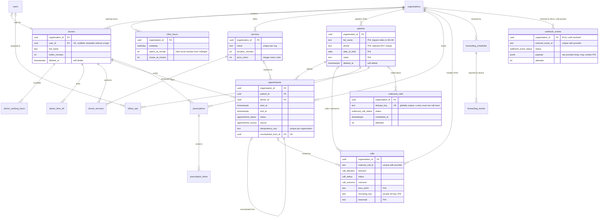

# ERD: clinic domain (M1-05)

Extends [the identity, tenancy and audit ERD](erd-identity-tenancy-audit.md). Generated from
`apps/api/prisma/schema.prisma`; update both together.

## Decisions worth knowing

**Opening hours are stored as clinic-local minutes from midnight, not as timestamps.**
`clinic_hours`, `doctor_working_hours` and `forwarding_schedules` all do this. A clinic that
opens at 09:00 opens at 09:00 on both sides of a DST transition; storing an instant would
shift it. The instant is derived at the edges from `organisations.timezone`.

**`patients.phone` is indexed but deliberately not unique.** Families share a number, and a
clinic may legitimately hold two records against one number until someone merges them. The
voice agent therefore links a caller to a patient only when exactly one record matches.

**`appointments.idempotency_key` is unique per organisation, not globally**, so two clinics
cannot collide on one key. It satisfies root CLAUDE.md rule 8 for the create path the voice
agent can reach.

**`outbound_calls.dedupe_key` IS globally unique.** A worker restart must never place a second
call to a patient (`apps/api/CLAUDE.md`), and the key is derived from what the call is for
rather than from when it was queued, so a retry collides with the original by construction.

**`webhook_events.organisation_id` is nullable.** A provider payload is stored before it is
understood, so the organisation is unknown at insert time. Unresolved rows are reachable only
with `app.platform = 'on'` — which is exactly who needs to see a webhook that failed to
resolve. `(provider, external_event_id)` is unique, which is what makes processing idempotent.

**Money is integer minor units** (`price_minor`, `cost_minor`); never a float.

**Soft deletes** on `patients`, `doctors` and `services`, because appointment and prescription
history must outlive the removal of the row it points at.

## Index coverage

Verified against the migrated database: **23 tables carry `organisation_id`, and every one of
them has at least one index whose FIRST column is `organisation_id`** — the ordering that
matters, since every tenant query filters on it before anything else.
