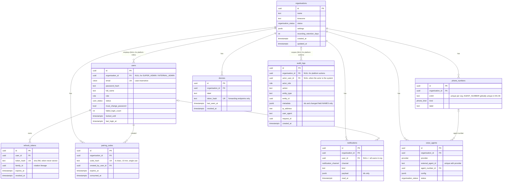

# ERD: identity, tenancy, audit (M1-04)

Generated from `apps/api/prisma/schema.prisma`. Update both together.

## Tables without an `organisation_id`, and why

M1-04 asks for this list explicitly, because a tenant-less table is a hole in the
database-level isolation lock unless it is justified.

| Table            | Why                                                                                                                                                                                         | How it is still protected                                                                                                                                                                                                                                                                                    |
| ---------------- | ------------------------------------------------------------------------------------------------------------------------------------------------------------------------------------------- | ------------------------------------------------------------------------------------------------------------------------------------------------------------------------------------------------------------------------------------------------------------------------------------------------------------ |
| `organisations`  | It **is** the tenant. Its primary key is the tenant id, so there is no `organisation_id` to carry.                                                                                          | M1-06 still applies a row-level security policy, keyed on `id` instead of `organisation_id`, so one clinic cannot read another's organisation row. This goes beyond the ticket's "every table with organisation_id" rule deliberately: without it, `organisations` would rely on the application lock alone. |
| `refresh_tokens` | Keyed to a user, who may be a platform user with no organisation. A nullable tenant column cannot satisfy an equality policy, so scoping it would weaken rather than strengthen the policy. | Reached only by the login and refresh paths, always through `asSystem`, never inside a tenant-scoped query. Holds no patient data and no plaintext token: only a SHA-256 hash, which is also `UNIQUE`, so a stolen hash cannot be replayed as a token.                                                       |

Two tables carry a **nullable** `organisation_id` rather than omitting it:

- `users` — NULL for `SUPER_ADMIN` and `INTERNAL_ADMIN`. The CHECK constraint that makes it
  required for clinic roles lands in M1-06.
- `audit_logs` — NULL for platform-level actions that belong to no organisation.

In both, NULL rows are invisible to a tenant query (`organisation_id = current_setting(...)`
is never true for NULL) and reachable only with `app.platform = 'on'`. That is the intended
behaviour: a clinic must not see platform users or platform audit entries.

## Conventions

- **UUID v7 primary keys generated in the application** (`apps/api/src/common/uuid.ts`), never
  by the database, so an id exists before the insert and can be used in the same transaction.
  v7 sorts by creation time, which keeps index inserts local and makes id-ordered cursor
  pagination stable.
- **snake_case in PostgreSQL, camelCase in TypeScript**, via `@map` / `@@map`.
- **`timestamptz`** for every instant. UTC is stored and transmitted; conversion to the
  clinic's timezone happens only at the edges.
- **Every composite index starts with `organisation_id`**, because every tenant query filters
  on it first.
- **`citext`** for `users.email`, so uniqueness and lookup are case-insensitive without every
  call site remembering to lower-case.
